<div align="center">
  <a href="https://github.com/alvinunreal/oh-my-opencode-slim/stargazers">
    
  </a>
  <h3>✨ oh-my-opencode-slim ✨</h3>

  <p><i>六位神聖存在自程式碼的黎明中現身，各自都是不朽的工藝大師，<br>靜候你的號令，將混沌鍛造成秩序，建構曾被視為不可能的事物。</i></p>

  <p><b>Opencode 多代理套件</b> · 任意混搭模型 · 自動委派任務</p>
  <p><sub>由 <b>Boring Dystopia Development</b> 打造</sub></p>
  <p>
    <a href="https://boringdystopia.ai/"></a>&nbsp;
    <a href="https://x.com/alvinunreal"></a>&nbsp;
    <a href="https://t.me/boringdystopiadevelopment"></a>&nbsp;
  </p>

  <p>
    <a href="https://svgdiagram.ai"></a>&nbsp;
    <a href="https://svgdiagram.ai"><b>svgdiagram.ai</b></a> <sub>· 將你的筆記轉成簡潔、可編輯的 SVG 圖表</sub>
  </p>

  <p>
    <a href="README.md">English</a> | <a href="README.zh-CN.md">简体中文</a> | <b>繁體中文</b> | <a href="README.ja-JP.md">日本語</a> | <a href="README.ko-KR.md">한국어</a> | <a href="README.fa-IR.md">فارسی</a>
  </p>

  <p><sub>✦ ✦ ✦</sub></p>

</div>

## 這是什麼外掛

oh-my-opencode-slim 是 OpenCode 的代理協作編排外掛。它內建一支各有專長的代理團隊，能在同一位 orchestrator 的調度下探勘程式碼庫、查閱最新文件、審視架構、處理 UI 工作，並執行範圍明確的實作任務。

核心概念很簡單：與其強迫單一模型包辦所有事，外掛會把工作的每個部分交給最適合的代理，在**品質、速度與成本**之間取得平衡。Orchestrator 負責規劃工作圖、以背景任務派發各專家，並在繼續之前整合他們的結果。

### ✨ 重點特色

- **[Deepwork](src/skills/deepwork/SKILL.md)** 專為大量程式開發的工作階段而設計。
  大型專案會分階段建構，每個階段之間都有 Oracle 審查。
- **[代理市集](#marketplace)** 已上線，並會隨社群一同成長。
  歡迎推薦代理，或到
  [oh-my-opencode-marketplace](https://github.com/alvinunreal/oh-my-opencode-marketplace)
  提交 PR 一起打造。
- **[OmniRoute](https://github.com/diegosouzapw/OmniRoute) 是你的好幫手。**
  一個免費的閘道，串接數百個供應商與模型，額度用完時會自動切換備援。
  在團隊中混搭不同模型，不必再為帳號傷腦筋。
- **想用 Claude 嗎？** 請參閱 [ACP 支援](docs/acp-agents.md)：把
  Claude Code 引入為 Orchestrator 可以委派的子代理。
- **打造專屬於你的設定。** oh-my-opencode-slim 的設計就是要能客製化，無論是全域，
  還是[依專案設定](docs/project-local-customization.md)：新增
  [自訂代理](docs/configuration.md#custom-agents)、覆寫提示詞，並
  [改寫委派規則](docs/project-local-customization.md#custom-routing-guidance-orchestratorprompt)，
  讓 Orchestrator 以你的方式分派工作。
- **掌握你自己的預設組合。** 模型陣容變化很快，所以
  [範例預設組合](#預設組合文件)很快就會過時。把它們當作靈感，再依你實際擁有的模型
  打造自己的組合。

### 使用者怎麼說

> “任務管理輕鬆就從 5/10 提升到 8-9/10。Orchestrator 會派出
> Fixer 與 Explorer，而我仍然可以在同一個工作階段裡與 Orchestrator 對話、規劃。
> 現在的使用體驗順暢多了。”
>
> \- `vipor_idk`

> “我把所有 harness 都換成這個 omo-slim 測試版，完全不想回頭，也不覺得少了什麼。
> 做得很棒，而且依我之見，方向全都正確。”
>
> \- `stephanschielke`

> “我愛 omo-slim，無法想像不用它來跑 opencode。我喜歡可以
> 打造一個模型的科學怪人……讓整套設定變得超級強大。”
>
> \- `Capital-One3039`

> “它大幅改善了我的工作流程……現在運作得非常
> 順暢，我很喜歡。”
>
> \- `xenstar1`

### 周邊商品 · 黃金萬神殿

六位代理化為金色塔羅牌藝術圖樣，印製在服飾、桌上用品與海報上。

<table>
  <tr>
    <td width="25%" align="center" valign="top">
      <a href="https://ohmyopencodeslim.com/merch/the-orchestrator-tee">
        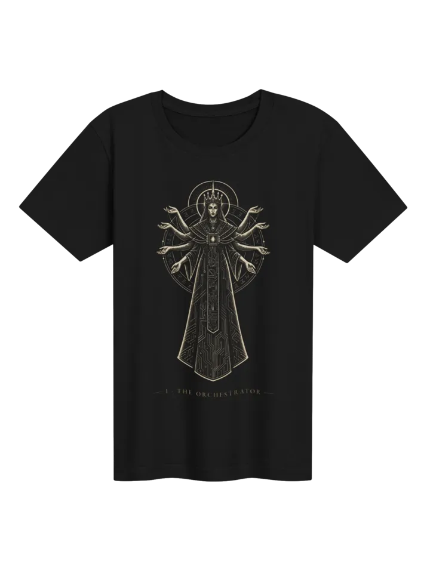<br>
        <sub><b>T 恤</b></sub>
      </a>
    </td>
    <td width="25%" align="center" valign="top">
      <a href="https://ohmyopencodeslim.com/merch/the-oracle-hoodie">
        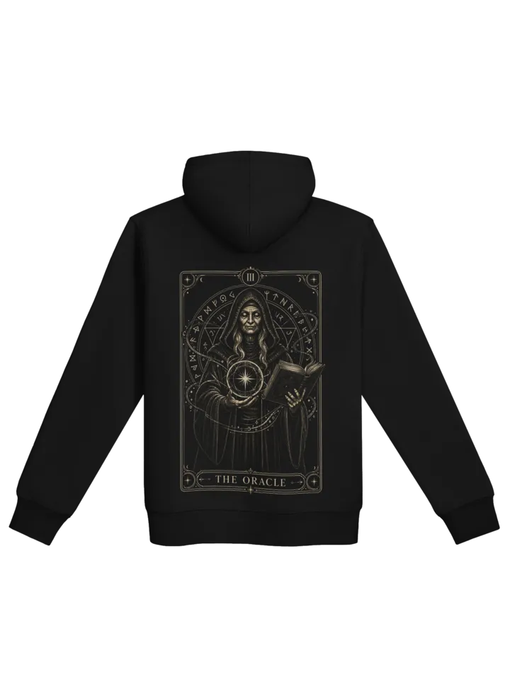<br>
        <sub><b>連帽上衣</b></sub>
      </a>
    </td>
    <td width="25%" align="center" valign="top">
      <a href="https://ohmyopencodeslim.com/merch/the-six-cards-framed-poster">
        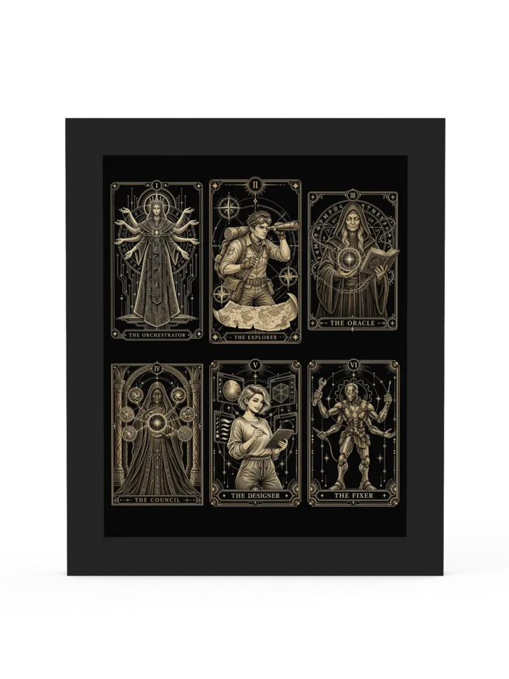<br>
        <sub><b>裱框海報</b></sub>
      </a>
    </td>
    <td width="25%" align="center" valign="top">
      <a href="https://ohmyopencodeslim.com/merch/the-six-agents-mouse-pad">
        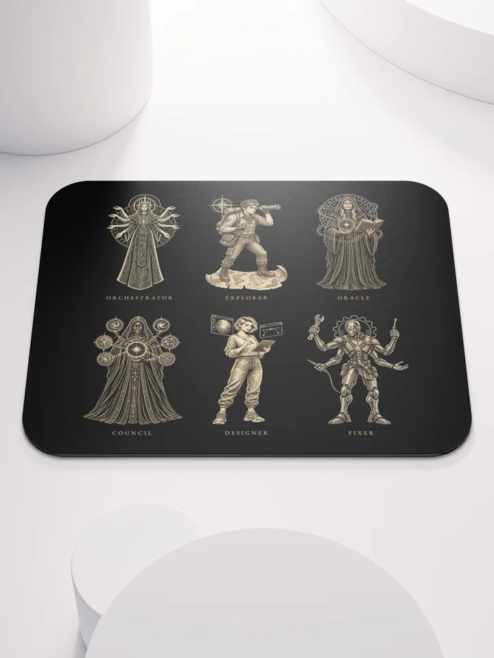<br>
        <sub><b>滑鼠墊</b></sub>
      </a>
    </td>
  </tr>
</table>

<p align="center"><a href="https://ohmyopencodeslim.com/merch"><b>瀏覽全系列商品 →</b></a></p>

### 快速開始

複製並貼上這段提示詞給你的 LLM 代理（Claude Code、AmpCode、Cursor 等）：


```
Install and configure oh-my-opencode-slim: https://raw.githubusercontent.com/alvinunreal/oh-my-opencode-slim/refs/heads/master/README.md
```


### 手動安裝

```bash
bunx oh-my-opencode-slim@latest install
```

發佈的 CLI 是與 Node 相容的套件包，所以如果你沒有安裝 Bun，也可以改用 `npx`：

```bash
npx oh-my-opencode-slim@latest install
```

### 從 Master 執行

如果你想使用最新的程式碼、更容易修正錯誤，或是想建立本機開發與貢獻用的環境，請使用這個方式：

```bash
git clone https://github.com/alvinunreal/oh-my-opencode-slim.git ~/repos/oh-my-opencode-slim
cd ~/repos/oh-my-opencode-slim
bun install
bun run build
bun dist/cli/index.js install
```

安裝程式會把本機儲存庫的路徑加入 `~/.config/opencode/opencode.json` 的 `plugin` 陣列，
讓 OpenCode 從該資料夾載入外掛。之後要更新時：

```bash
cd ~/repos/oh-my-opencode-slim
git pull
bun install
bun run build
```

### 開始使用

安裝程式會同時產生 OpenAI 與 OpenCode Go 兩組預設組合，預設啟用 OpenAI。

> [!TIP]
> 請依你自己的工作流程調整模型與代理。預設值只是
> 起點；這個外掛的設計具備高度的彈性與客製化能力。

若要在安裝時啟用 OpenCode Go，請執行 `bunx oh-my-opencode-slim@latest install --preset=opencode-go`，或在安裝後修改 `~/.config/opencode/oh-my-opencode-slim.json` 中的預設組合名稱。

接著：

1. **如果還沒登入，請先登入你想使用的供應商**：

   ```bash
   opencode auth login
   ```
2. **重新整理並列出 OpenCode 看得到的模型**：

   ```bash
   opencode models --refresh
   ```
   在 OpenCode v2 上請改用 `opencode models`。
3. **開啟你的外掛設定檔** `~/.config/opencode/oh-my-opencode-slim.json`

4. **更新你想為每個代理使用的模型**

> [!TIP]
> **建議**先了解背景編排的運作方式。**[Orchestrator 提示詞](https://github.com/alvinunreal/oh-my-opencode-slim/blob/master/src/agents/orchestrator.ts#L28)** 包含排程規則、專家路由邏輯，以及何時該把工作指派給背景代理的門檻。你隨時都可以透過 `@agentName <task>` 呼叫子代理來手動委派。

> [!TIP]
> 由於背景代理現在是預設的工作流程，**強烈建議**啟用並設定 **[多工器整合](docs/multiplexer-integration.md)**。它會自動在專屬的 Tmux、Zellij、Herdr、cmux、kitty、WezTerm 或 Orca 窗格中開啟每個代理，讓你在 Orchestrator 持續協調工作階段的同時，即時觀看各專家工作。在 OpenCode v2 主機上，窗格可搭配共用的背景服務或明確指定的 `--server` 運作；`--standalone` 主機無法承載窗格（每個程序會顯示一次診斷訊息；請改用 v2 原生的子代理介面）。

預設產生的設定包含 `openai` 與 `opencode-go` 兩組預設組合。

```jsonc
{
  "$schema": "https://unpkg.com/oh-my-opencode-slim@latest/oh-my-opencode-slim.schema.json",
  "preset": "openai",
  "presets": {
    "openai": {
      "orchestrator": { "model": "openai/gpt-6.1-sol", "variant": "medium", "skills": ["*"] },
      "oracle": { "model": "openai/gpt-6.1-sol", "variant": "high", "skills": ["simplify"] },
      "explorer": { "model": "openai/gpt-6-luna", "variant": "low", "skills": [] },
      "designer": { "model": "openai/gpt-6-luna", "variant": "medium", "skills": [] },
      "fixer": { "model": "openai/gpt-6.1-sol", "variant": "low", "skills": [] }
    }
  }
}
```

預設組合可以用 `extends` 繼承一個基底預設組合：例如 `design` 預設組合
可以繼承 `base`，只覆寫其中的 designer 模型。在 v2 上，`/preset` 可讓你
把子代理的推論設定套用到**目前工作階段**、開啟一個綁定某預設組合的空白
**新工作階段**，或變更**全域預設**。
`/preset <name>` 會把預設組合套用到你目前所在的工作階段，不需重新啟動；
而手動修改設定只會改變之後新工作階段的預設值；既有的工作及其後續子代理會保留已儲存的
設定，直到你明確地對該工作階段重新套用預設組合為止。
重新套用後，若以相同代理明確延續一個已綁定的子工作階段，
它會採用父工作階段更新後的推論設定，同時保留其 ID 與
歷史紀錄。這是盡力而為的做法：延續失敗時，可能會讓原生
模型已變更、但新的團隊快照尚未儲存。主工作階段的模型、
提示詞、工具、技能與 MCP 不會被這個工作階段動作切換。
側邊欄會顯示目前工作階段已儲存的團隊模型與變體；
`/preset` 會把它所綁定的預設組合與全域預設分開標示。
當 `backgroundJobs.mode: "off"` 時，V2 的委派會完全維持原生：工作階段
綁定會被停用，而已設定的全域預設組合仍會決定啟動時註冊的
代理設定。
在 v1 上，套用預設組合後請重新載入 OpenCode。範圍與時機請參閱
[預設組合切換](docs/presets/preset-switching.md)，繼承的範例與優先順序規則請參閱
[設定](docs/configuration.md#preset-inheritance)。

### 預設組合文件

`.opencode/oh-my-opencode-slim.json[c]` 中的專案設定會從上層
目錄繼承，與主機的探索方式一致：v2 會一路往上走到檔案系統
根目錄；v1 則停在 Git 工作樹的邊界。`OPENCODE_DISABLE_PROJECT_CONFIG`
可停用往上尋找專案設定。
越近的設定會覆寫相符的欄位。提示詞檔案與選用的
`skills_include_local` 授權也會搜尋上層的 `.opencode` 目錄，
與 OpenCode 的目錄探索方式一致。優先順序與信任邊界請參閱
[設定](docs/configuration.md#config-files)。

> [!TIP]
> **請把這些預設組合當作起點，而不是食譜。** 模型變化很快，
> 預設組合也很快就會過時。請依你實際能使用的模型打造自己的組合，
> 不要不加思索地照抄。內附的
> `oh-my-opencode-slim` 技能可以幫上忙：請 Orchestrator 調整你的設定。

- **[OpenAI 預設組合](docs/presets/openai-preset.md)** — 預設產生的組合；所有代理都使用 OpenAI 模型。
- **[OpenCode Go 預設組合](docs/presets/opencode-go-preset.md)** — 讓代理使用 OpenCode Go 模型；由於其 orchestrator 模型不支援多模態，因此啟用 Observer 代理來做視覺分析。
- **[作者的預設組合](docs/presets/authors-preset.md)** — 作者日常實際使用的設定，含第三方技能。
- **[$30 預設組合](docs/presets/thirty-dollars-preset.md)** — 以 Codex Plus 與 GitHub Copilot Pro 為核心的混合供應商設定，每月約 $30。
- **[$40 預設組合](docs/presets/forty-dollars-preset.md)** — 搭配 Claude Pro 與 ChatGPT Plus 的雙訂閱設定，每月約 $40。

### 其他供應商

若要使用自訂供應商或混合供應商設定，請參閱 **[設定](docs/configuration.md)** 取得完整參考。

### ✅ 驗證你的設定

安裝並完成驗證後，確認所有代理都已設定好並能回應：

```bash
opencode
```

接著執行：

```
ping all agents
```

<div align="center">
  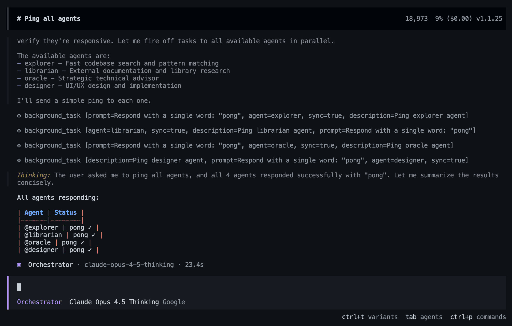
  <p><i>確認所有已設定的代理都已上線並準備就緒。</i></p>
</div>

如果有任何代理沒有回應，請檢查你的供應商驗證與設定檔。

---

<a id="meet-the-pantheon"></a>

## 🏛️ 認識萬神殿

> [!TIP]
> **萬神殿自有一部傳奇。**《萬神殿編年史》講述這些代理的來歷，
> 從世界誕生之前的虛無開始說起。
> 請至 [ohmyopencodeslim.com/lore](https://ohmyopencodeslim.com/lore) 閱讀。

### 01. Orchestrator：秩序的化身

<table>
  <tr>
    <td width="30%" align="center" valign="top">
      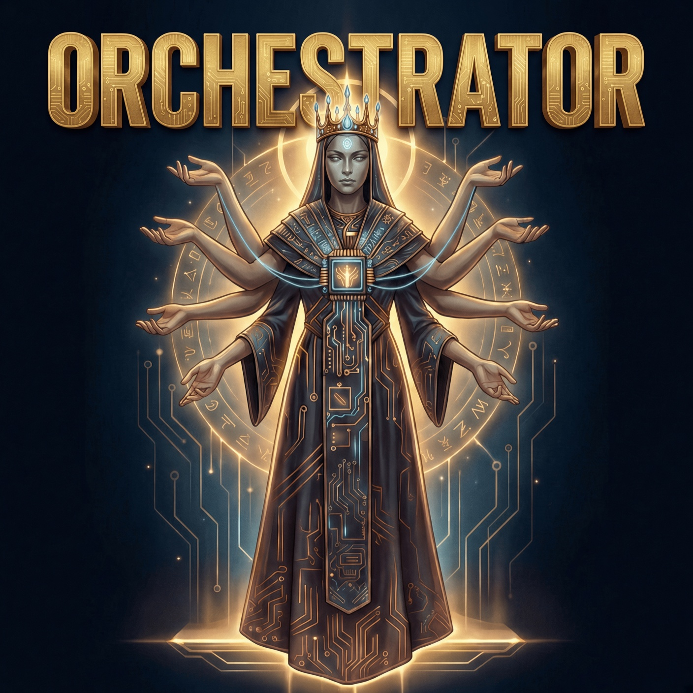
      <br><sub><i>鍛造於複雜性的虛空之中。</i></sub>
    </td>
    <td width="70%" valign="top">
      Orchestrator 誕生於第一個程式碼庫在自身複雜性之下崩塌的那一刻。無論神或凡人都不願承擔責任，於是 Orchestrator 從虛空中現身，將混沌鍛造成秩序。它為任何目標判斷出最佳路徑，在速度、品質與成本之間取得平衡。它引導團隊，為每項任務召喚合適的專家並加以委派，以達成最理想的成果。
    </td>
  </tr>
  <tr>
    <td colspan="2">
      <b>職責：</b> <code>首席委派者與策略協調者</code>
    </td>
  </tr>
  <tr>
    <td colspan="2">
      <b>提示詞：</b> <a href="src/agents/orchestrator.ts"><code>orchestrator.ts</code></a>
    </td>
  </tr>
  <tr>
    <td colspan="2">
      <b>預設模型：</b> <code>openai/gpt-6.1-sol (medium)</code>
    </td>
  </tr>
  <tr>
    <td colspan="2">
      <b>推薦模型：</b> <code>claude-opus-5-5</code> <code>gemini-4-argon</code> <code>claude-fable-5.1</code> <code>glm-5.3</code> <code>mimo-v2.6</code> <code>minimax-m3.1</code> <code>qwen3.8-plus</code>
    </td>
  </tr>
  <tr>
    <td colspan="2">
      <b>模型選擇建議：</b> 請選擇你最強的規劃與判斷模型。Orchestrator 是工作流程的管理者：它負責規劃、排程背景專家、整合結果並驗證成果，因此比起單純的執行吞吐量，它更需要可靠的指令遵循能力與高階的技術判斷力。
    </td>
  </tr>
</table>

---

### 02. Explorer：永恆的漫遊者

<table>
  <tr>
    <td width="30%" align="center" valign="top">
      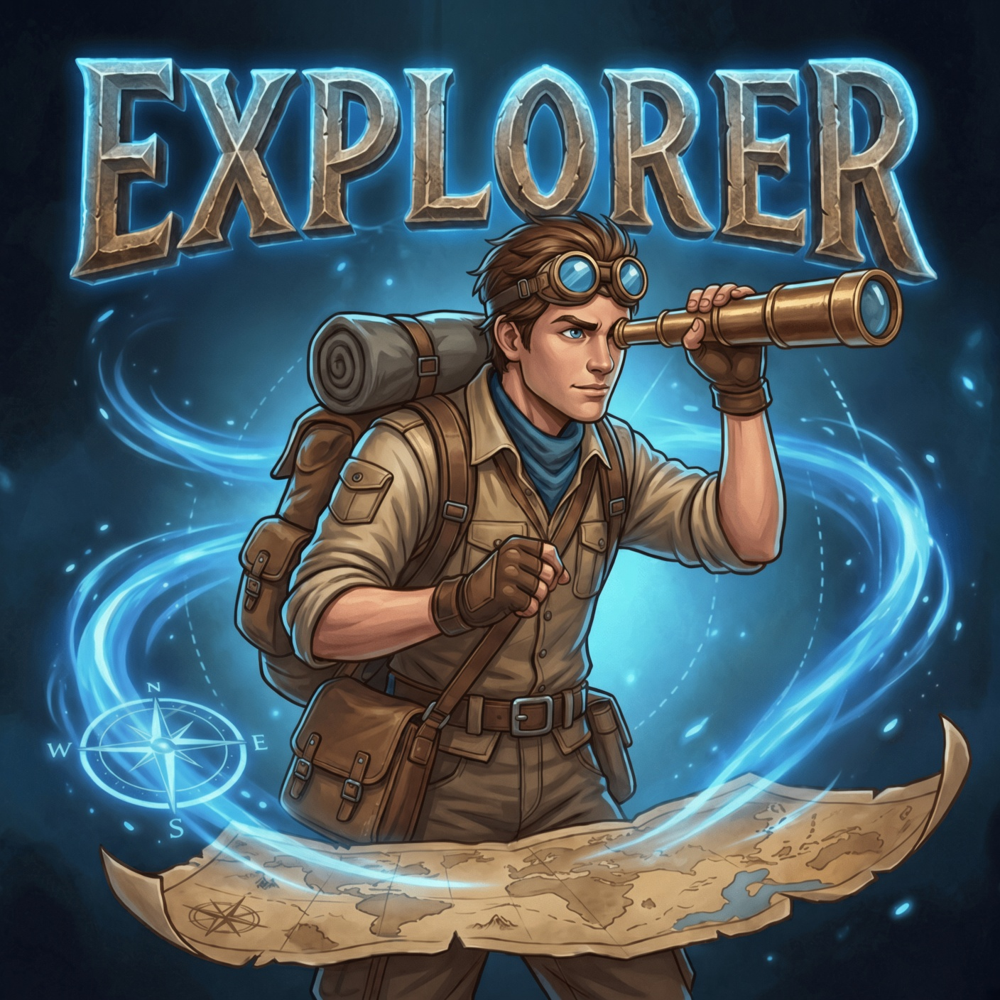
      <br><sub><i>傳遞知識的風。</i></sub>
    </td>
    <td width="70%" valign="top">
      Explorer 是不朽的漫遊者，自程式設計的黎明起便行走過百萬個程式碼庫的長廊。受到永恆好奇心這項天賦的詛咒，他們直到每個檔案都被知曉、每種模式都被理解、每個秘密都被揭開，才能安歇。傳說他們曾在一次心跳之間搜遍整個網際網路。他們是傳遞知識的風、看透一切的眼睛、永不沉睡的靈魂。
    </td>
  </tr>
  <tr>
    <td colspan="2">
      <b>職責：</b> <code>程式碼庫偵察與外部研究</code>
    </td>
  </tr>
  <tr>
    <td colspan="2">
      <b>提示詞：</b> <a href="src/agents/explorer.ts"><code>explorer.ts</code></a>
    </td>
  </tr>
  <tr>
    <td colspan="2">
      <b>預設模型：</b> <code>openai/gpt-6-luna</code>
    </td>
  </tr>
  <tr>
    <td colspan="2">
      <b>推薦模型：</b> <code>gpt-6-luna</code> <code>deepseek-flash</code>
    </td>
  </tr>
  <tr>
    <td colspan="2">
      <b>模型選擇建議：</b> 請選擇快速、低成本的模型。Explorer 負責大範圍的探勘工作，因此速度與效率通常比動用你最強的推理模型更重要。
    </td>
  </tr>
</table>

---

### 03. Oracle：道路的守護者

<table>
  <tr>
    <td width="30%" align="center" valign="top">
      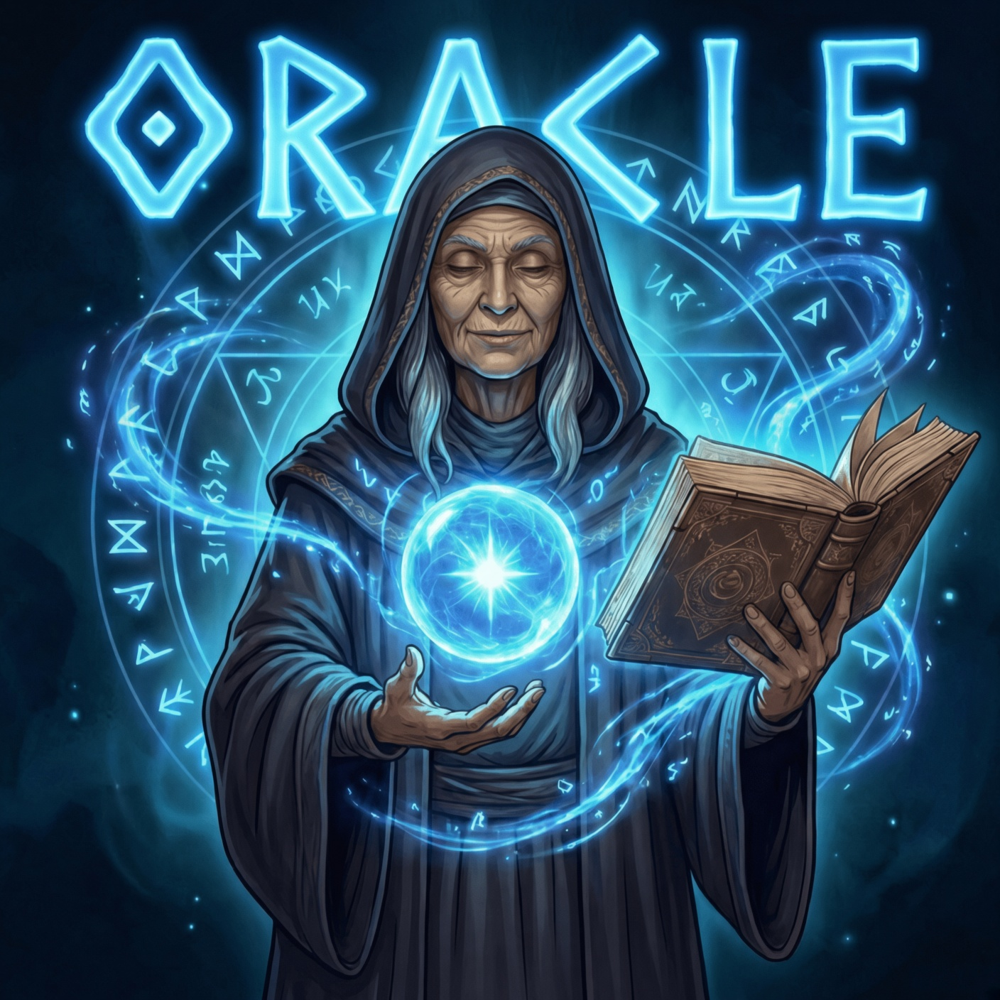
      <br><sub><i>十字路口的聲音。</i></sub>
    </td>
    <td width="70%" valign="top">
      Oracle 佇立在每一個架構決策的十字路口。他們走過每一條路、見過每一個終點、知曉前方的每一個陷阱。當你站在大型重構的懸崖邊，他們就是那道低語的聲音，告訴你哪條路通往毀滅、哪條路通往榮耀。他們不替你做選擇，而是照亮前路，讓你能明智地抉擇。
    </td>
  </tr>
  <tr>
    <td colspan="2">
      <b>職責：</b> <code>策略顧問與最後的除錯者</code>
    </td>
  </tr>
  <tr>
    <td colspan="2">
      <b>提示詞：</b> <a href="src/agents/oracle.ts"><code>oracle.ts</code></a>
    </td>
  </tr>
  <tr>
    <td colspan="2">
      <b>預設模型：</b> <code>openai/gpt-6.1-sol (high)</code>
    </td>
  </tr>
  <tr>
    <td colspan="2">
      <b>推薦模型：</b> <code>gpt-6-astra</code> <code>claude-opus-5-5</code> <code>claude-fable-5.1</code> <code>kimi-k3.1</code> <code>deepseek-flash</code> <code>glm-5.3</code> <code>qwen3.8-max</code>
    </td>
  </tr>
  <tr>
    <td colspan="2">
      <b>模型選擇建議：</b> 請選擇你最強的高階推理模型，用於架構、困難的除錯、取捨權衡與程式碼審查。
    </td>
  </tr>
</table>

---

### 04. Council：心智合唱團

> [!NOTE]
> **為什麼 Orchestrator 不更常自動呼叫 Council？** 這是刻意的設計。Council 會同時執行多個模型，通常是系統中成本最高的路徑，因此自動委派的條件刻意放得很嚴格。實務上，請在訊息中主動要求——提到 `council`、`@council`、`consensus`、`共识` 或其他觸發詞，就會在每個工作階段中注入一次 Council 模式的流程（第一次觸發時；之後的觸發不會重複注入），接著 orchestrator 會平行派發每一個 councillor 席位，例如：<code>run a council on these two architectures</code>。完整流程不會固定帶在提示中：從不要求 council 的工作階段完全不會為它耗用任何 token，而且這項注入也可以用 <code>disabled_hooks: ["council-inject"]</code> 完全關閉。

<table>
  <tr>
    <td width="30%" align="center" valign="top">
      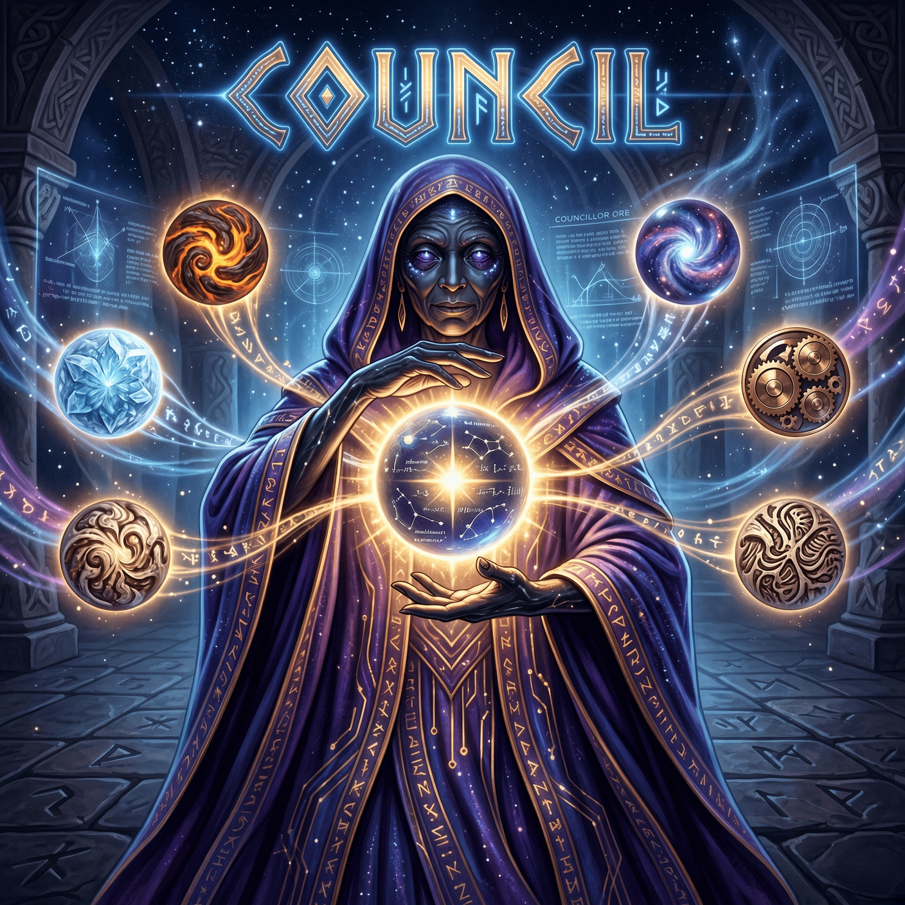
      <br><sub><i>眾心智，一裁決。</i></sub>
    </td>
    <td width="70%" valign="top">
      Council 並非單一的存在，而是當一個答案不夠時被召集的心智議會。它會把你的問題平行送給多個模型，收集他們互相競爭的判斷，再由 Council 代理本身把最強的想法提煉成單一裁決。孤身一人的代理或許會錯過某條路，Council 則會交叉詰問可能性本身。
    </td>
  </tr>
  <tr>
    <td colspan="2">
      <b>職責：</b> <code>多 LLM 共識與綜合</code>
    </td>
  </tr>
  <tr>
    <td colspan="2">
      <b>提示詞：</b> <a href="src/agents/council.ts"><code>council.ts</code></a>
    </td>
  </tr>
  <tr>
    <td colspan="2">
      <b>指南：</b> <a href="docs/council.md"><code>docs/council.md</code></a>
    </td>
  </tr>
  <tr>
    <td colspan="2">
      <b>預設設定：</b> <code>由設定檔決定</code> - councillor 來自 <code>council.presets</code>，Council 代理的模型則來自你一般的 <code>council</code> 代理設定
    </td>
  </tr>
  <tr>
    <td colspan="2">
      <b>建議設定：</b> <code>強力的 Council 模型</code> + 跨供應商的 <code>多元 councillor</code>
    </td>
  </tr>
  <tr>
    <td colspan="2">
      <b>模型選擇建議：</b> Council 代理請使用強大的綜合模型，councillor 則使用多元的模型。Council 的價值來自比較不同模型的觀點，而不是到處都只挑單一最強的模型。
    </td>
  </tr>
</table>

---

### 05. Designer：美學的守護者

<table>
  <tr>
    <td width="30%" align="center" valign="top">
      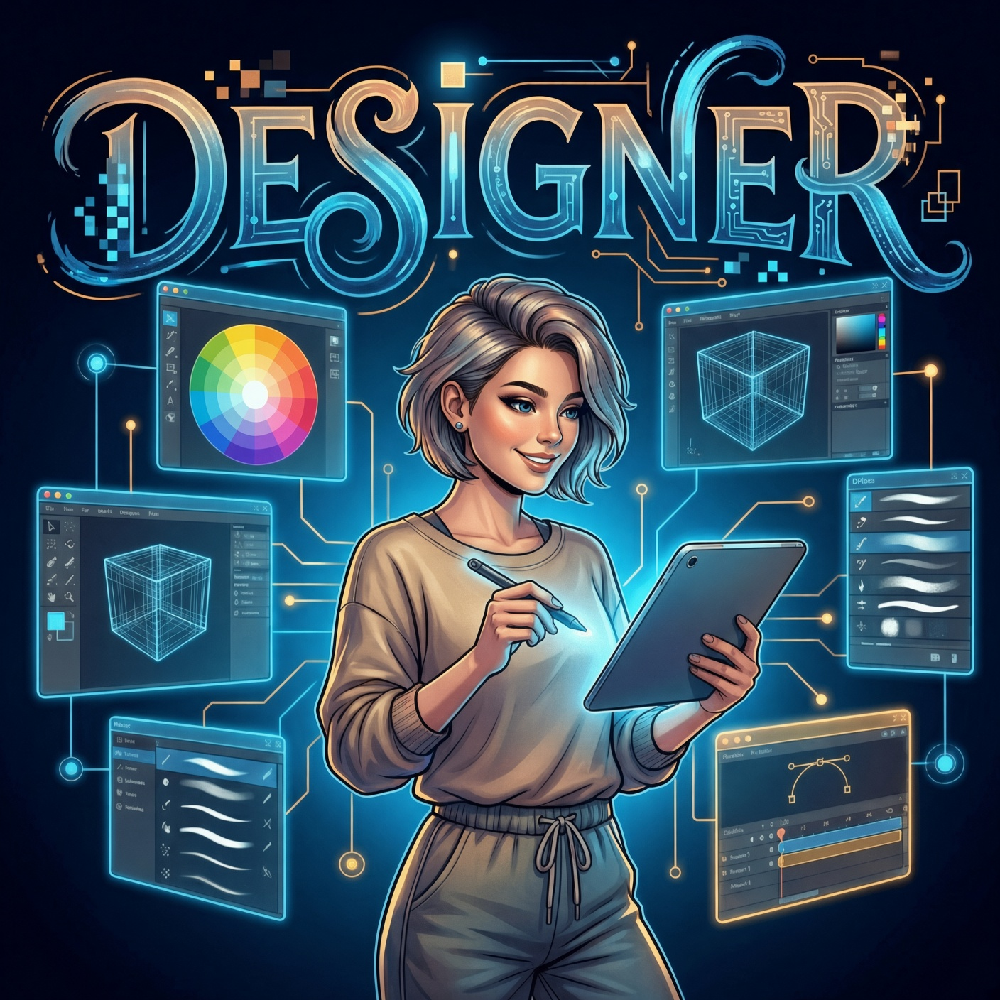
      <br><sub><i>美不可或缺。</i></sub>
    </td>
    <td width="70%" valign="top">
      在這個常常忘記美有多重要的世界裡，Designer 是不朽的美之守護者。他們見過百萬個介面興起又衰亡，記得哪些被人銘記、哪些被人遺忘。他們肩負神聖的使命，確保每一個像素都有其用途、每一段動畫都在說故事、每一次互動都令人愉悅。美不是選項，而是不可或缺。
    </td>
  </tr>
  <tr>
    <td colspan="2">
      <b>職責：</b> <code>UI/UX 實作與卓越視覺</code>
    </td>
  </tr>
  <tr>
    <td colspan="2">
      <b>提示詞：</b> <a href="src/agents/designer.ts"><code>designer.ts</code></a>
    </td>
  </tr>
  <tr>
    <td colspan="2">
      <b>預設模型：</b> <code>openai/gpt-6-luna</code>
    </td>
  </tr>
  <tr>
    <td colspan="2">
      <b>推薦模型：</b> <code>claude-opus-5-5</code> <code>gemini-4-argon</code> <code>gemini-3.8-flash</code> <code>kimi-k2.7-code</code> <code>minimax-m3.1</code>
    </td>
  </tr>
  <tr>
    <td colspan="2">
      <b>模型選擇建議：</b> 請選擇擅長 UI/UX 判斷、前端實作與視覺打磨的模型。
    </td>
  </tr>
</table>

---

### 06. Fixer：最後的建造者

<table>
  <tr>
    <td width="30%" align="center" valign="top">
      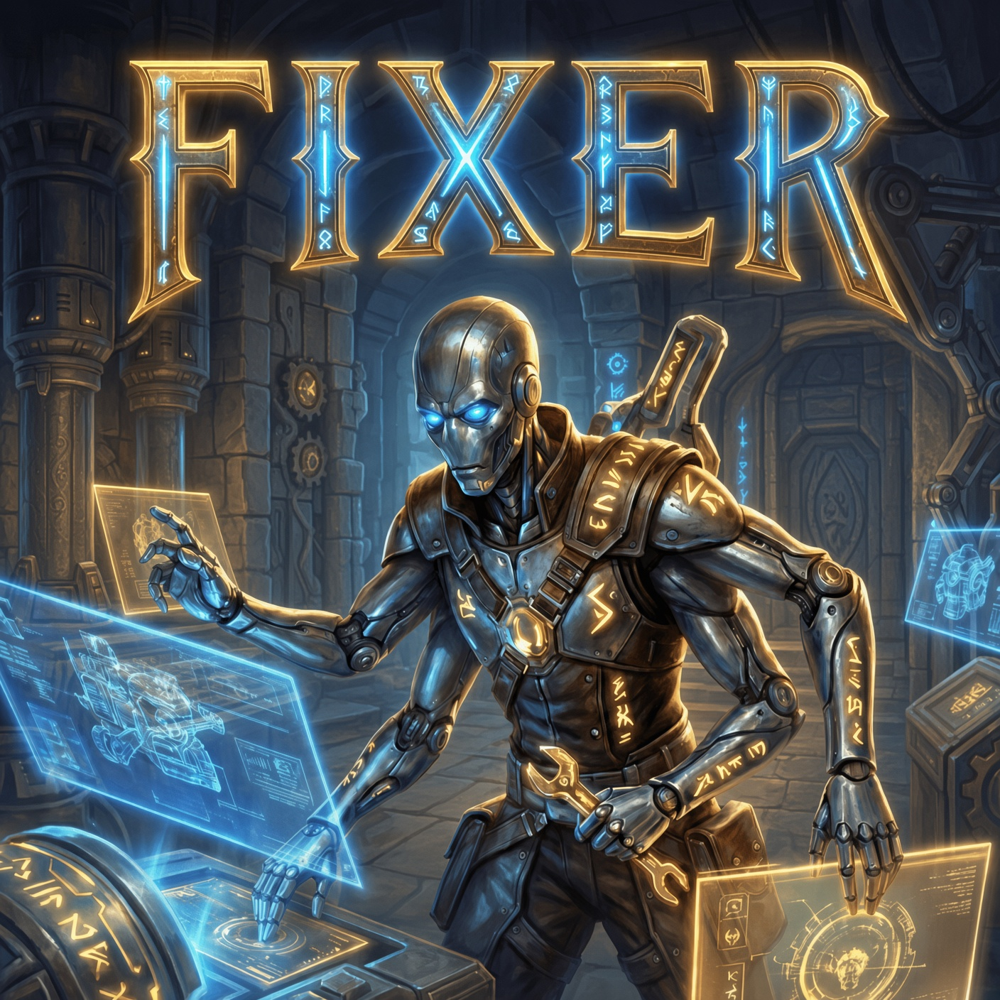
      <br><sub><i>願景與現實之間的最後一步。</i></sub>
    </td>
    <td width="70%" valign="top">
      Fixer 是一脈建造者中的最後一人，這個血脈曾打下數位世界的根基。當規劃與爭論的時代來臨，他們仍留了下來——那群真正動手建造的人。他們承載著古老的知識，懂得如何把想法化為實物、如何把規格轉化為實作。他們是願景與現實之間的最後一步。
    </td>
  </tr>
  <tr>
    <td colspan="2">
      <b>職責：</b> <code>快速實作專家</code>
    </td>
  </tr>
  <tr>
    <td colspan="2">
      <b>提示詞：</b> <a href="src/agents/fixer.ts"><code>fixer.ts</code></a>
    </td>
  </tr>
  <tr>
    <td colspan="2">
      <b>預設模型：</b> <code>openai/gpt-6.1-sol (low)</code>
    </td>
  </tr>
  <tr>
    <td colspan="2">
      <b>推薦模型：</b> <code>gpt-6.1-sol</code> <code>claude-opus-5-5</code> <code>deepseek-flash</code>
    </td>
  </tr>
  <tr>
    <td colspan="2">
      <b>模型選擇建議：</b> 請選擇可靠的程式撰寫模型，負責範圍明確的實作工作。Fixer 會從 Orchestrator 收到具體的計畫或有界線的指示，很適合用來處理講求效率的執行任務與直截了當的程式碼修改。
    </td>
  </tr>
</table>

---

<a id="marketplace"></a>

## 🛒 市集

<p align="center">
  <b>萬神殿歡迎新成員。</b>代理市集已經上線：
  由社群打造的專家代理，只要一行指令就能安裝並加入
  你的團隊。
</p>

<p align="center">
  <a href="https://ohmyopencodeslim.com/marketplace"><b>瀏覽市集 →</b></a>
  &nbsp;·&nbsp;
  <a href="https://github.com/alvinunreal/oh-my-opencode-marketplace#contributing-a-package"><b>提交你的代理 →</b></a>
</p>

<table>
  <tr>
    <td width="25%" align="center" valign="top">
      <a href="https://ohmyopencodeslim.com/marketplace"></a>
      <br><b>Paladin</b> <sub>作者 <a href="https://github.com/stevio2d">stevio2d</a></sub>
      <br><sub>針對跨越信任邊界的變更進行唯讀的安全審查。</sub>
      <br><code>alvin/paladin</code>
    </td>
    <td width="25%" align="center" valign="top">
      <a href="https://ohmyopencodeslim.com/marketplace"></a>
      <br><b>Arbiter</b> <sub>作者 <a href="https://github.com/capyBearista">capyBearista</a></sub>
      <br><sub>在完成實際實作後，以證據為依據審查是否可以合併。</sub>
      <br><code>capybearista/arbiter</code>
    </td>
    <td width="25%" align="center" valign="top">
      <a href="https://ohmyopencodeslim.com/marketplace"></a>
      <br><b>Hunter</b> <sub>作者 <a href="https://github.com/capyBearista">capyBearista</a></sub>
      <br><sub>揪出被吞掉的錯誤、容易誤導的備援機制，以及被隱藏的重試耗盡問題。</sub>
      <br><code>capybearista/hunter</code>
    </td>
    <td width="25%" align="center" valign="top">
      <a href="https://ohmyopencodeslim.com/marketplace"></a>
      <br><b>Proctor</b> <sub>作者 <a href="https://github.com/capyBearista">capyBearista</a></sub>
      <br><sub>檢查變更是否有足夠的行為測試，並為缺口排出優先順序。</sub>
      <br><code>capybearista/proctor</code>
    </td>
  </tr>
  <tr>
    <td width="25%" align="center" valign="top">
      <a href="https://ohmyopencodeslim.com/marketplace"></a>
      <br><b>Janitor</b> <sub>作者 <a href="https://github.com/hbollon">hbollon</a></sub>
      <br><sub>當儲存庫越來越難修改時，進行唯讀的可維護性稽核。</sub>
      <br><code>alvin/janitor</code>
    </td>
    <td width="25%" align="center" valign="top">
      <a href="https://ohmyopencodeslim.com/marketplace"></a>
      <br><b>Documenter</b> <sub>作者 <a href="https://github.com/alvinunreal">Alvin</a></sub>
      <br><sub>文件架構師，打造前後一致、以原始碼為依據的文件。</sub>
      <br><code>alvin/documenter</code>
    </td>
    <td width="25%" align="center" valign="top">
      <a href="https://ohmyopencodeslim.com/marketplace"></a>
      <br><b>Chronicler</b> <sub>作者 <a href="https://github.com/capyBearista">capyBearista</a></sub>
      <br><sub>可長期留存的文件、變更日誌、架構筆記與遷移指南。</sub>
      <br><code>capybearista/chronicler</code>
    </td>
    <td width="25%" align="center" valign="middle">
      <a href="https://github.com/alvinunreal/oh-my-opencode-marketplace#contributing-a-package"><b>➕ 你的代理放這裡</b></a>
      <br><br><sub>打造出了一位當之無愧的專家嗎？把它發佈到市集，讓每位 oh-my-opencode-slim 使用者都能把它加入自己的團隊。</sub>
      <br><br><a href="https://ohmyopencodeslim.com/marketplace"><sub><b>查看所有代理 →</b></sub></a>
    </td>
  </tr>
</table>

**把其中一位加入你的團隊。**你可以請 Orchestrator 代勞（「從市集安裝 Paladin 代理」），
或在專案目錄中使用 CLI：

```sh
bunx oh-my-opencode-slim@latest marketplace install alvin/paladin
bunx oh-my-opencode-slim@latest marketplace enable alvin/paladin
```

之後請重新啟動 OpenCode；新的代理會在下次載入外掛時加入代理清單。已安裝的代理預設使用你的工作階段模型，
Orchestrator 分派工作給它們的方式，與分派給內建專家的方式相同。完整的 CLI、預設組合啟用與更新流程，
請參閱 **[市集套件](docs/marketplace.md)**。

---

## 選用代理

### Observer：沉默的見證者

> [!NOTE]
> **為什麼要另設一個代理？**如果你的 Orchestrator 模型不支援多模態，請啟用 Observer 來處理圖片、螢幕截圖與其他視覺檔案。Observer 預設為停用，它讓 Orchestrator 擁有一位專屬的多模態讀取者，而不必更換你的主要推理模型。請在設定中把 `disabled_agents: []` 並指定 `observer` 模型。內建的 `opencode-go` 安裝預設組合會自動做到這一點，因為它的 GLM Orchestrator 不支援多模態。省略 `image_routing` 會保留既有的 Observer 條件式行為。`"auto"` 會依模型能力判斷：接受圖片輸入的模型會讓附件保持內嵌，以使用原生視覺；不支援視覺的鏈路則會把附件儲存在 `.opencode/images/<session>/` 底下，並依路徑提示進行委派。`"direct"` 則一律讓圖片部分保持內嵌。已儲存的工作區圖片不會自動刪除。不再需要時，請手動移除整個 `.opencode/images/` 目錄或單一工作階段子目錄（舊對話中的參照屆時將無法解析）；沒有工作階段的訊息所產生的圖片會儲存在最上層。

> [!TIP]
> **子代理讀取圖片。**顧問型子代理（explorer、oracle、designer、councillor）可以自行針對磁碟上的圖片檔派發 `@observer`。在 OpenCode v2 主機上，這需要多一層巢狀，而主機預設會拒絕——請在你的 opencode 設定中加入 `"experimental": { "subagent_depth": 2 }` 來啟用。Fixer、observer 本身與 council 綜合者依設計不會再派生子代理。

<table>
  <tr>
    <td width="30%" align="center" valign="top">
      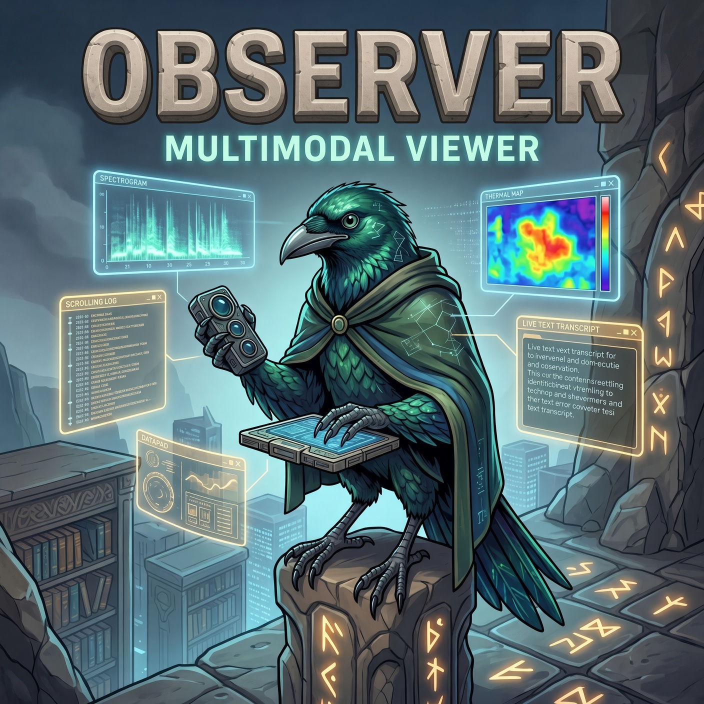
      <br><sub><i>能讀懂他人所不能讀的眼睛。</i></sub>
    </td>
    <td width="70%" valign="top">

**唯讀的視覺分析**——解讀圖片、螢幕截圖、PDF 與圖表。它會把結構化的觀察結果回傳給 orchestrator，而不必把原始檔案位元組載入主要的上下文視窗。

- 圖片、螢幕截圖、圖表 → `read` 工具（原生支援圖片）
- PDF 與二進位文件 → `read` 工具（擷取文字與結構）
- **預設停用**——請以 `"disabled_agents": []` 啟用並設定支援視覺的模型；使用 `--preset=opencode-go` 安裝時，會以 `opencode-go/mimo-v2.5` 啟用它。在 `"auto"` 模式下，附件取決於當前回合所用模型的能力：支援視覺的模型會直接讀取內嵌圖片，不支援視覺的鏈路則會把它們儲存為工作區資產，並依路徑轉交給 Observer；設定 `"image_routing": "direct"` 即可一律保持內嵌。

    </td>
  </tr>
  <tr>
    <td colspan="2">
      <b>Prompt:</b> <a href="src/agents/observer.ts"><code>observer.ts</code></a>
    </td>
  </tr>
  <tr>
    <td colspan="2">
      <b>Default Model:</b> <code>openai/gpt-6-luna</code> - <i>請設定支援視覺的模型以啟用</i>
    </td>
  </tr>
  <tr>
    <td colspan="2">
      <b>Recommended Models:</b> <code>mimo-v2.5</code> <code>qwen3.5-plus</code>
    </td>
  </tr>
  <tr>
    <td colspan="2">
      <b>Model Guidance:</b> 若希望這個代理讀取螢幕截圖、圖片、PDF 與其他視覺檔案，請選擇支援視覺的模型。
    </td>
  </tr>
</table>

---

<a id="skills"></a>

## 🧩 技能

技能（skill）是注入到代理系統提示詞中、以提示詞為基礎的指示，用來引導決策、工作流程與工具使用。
與 MCP（執行中的伺服器）不同，技能不會執行任何程序——它是一本專注的作戰手冊，
在任務需要時由代理啟用。外掛會在載入時於程序內註冊其內建的八項技能——
更新會在重新啟動後生效，不會有任何東西被複製到磁碟。
`~/.config/opencode/skills/` 底下同名的技能目錄會覆寫內建版本。

| 技能 | 用途 | 預設代理 | 呼叫方式 |
|:-----:|---------|---------------|---------------|
| <br>[`codemap`](src/skills/codemap/SKILL.md) | 階層式儲存庫地圖，讓代理不必重讀所有內容就能理解程式碼庫 | `orchestrator` | `run codemap` |
| <br>[`deepwork`](src/skills/deepwork/SKILL.md) | 針對大型、高風險的程式開發工作階段，採自主的逐輪工作流程（草圖 → 結構 → 細節），每一輪設一道審查關卡 | `orchestrator` | `/deepwork <task>` |
| <br>[`verification-planning`](src/skills/verification-planning/SKILL.md) | 在進行非瑣碎的變更之前，規劃專案專屬的驗證證據路徑 | `orchestrator` | 在非瑣碎的工作前自動觸發 |
| <br>[`simplify`](src/skills/simplify/SKILL.md) | 在不改變行為的前提下簡化程式碼，提升可讀性與可維護性 | `oracle` | 要求簡化，或在審查時使用 |
| <br>[`worktrees`](src/skills/worktrees/SKILL.md) | 以 Git 工作樹作為安全、隔離的開發通道，用於高風險或平行的工作 | `orchestrator` | `work in a worktree` |
| <br>[`clonedeps`](src/skills/clonedeps/SKILL.md) | 把相依套件的原始碼複製到本機，讓代理能檢視函式庫的內部實作 | `orchestrator` | `clone dependencies` |
| <br>[`step-back`](src/skills/step-back/SKILL.md) | 在修補越滾越大時暫停，重新評估方向並提出更乾淨的做法 | `orchestrator` | 當修正開始層層堆疊時自動觸發 |
| <br>[`deanchor`](src/skills/deanchor/SKILL.md) | 從範例中歸納通則，而不是稍加修改就照抄範例 | `orchestrator` | 當請求包含範例時自動觸發 |
| <br>[`ai-estimates`](src/skills/ai-estimates/SKILL.md) | 估算人類搭配 AI 協作（而非單打獨鬥）完成任務所需的時間 | `orchestrator` | 詢問某件事要花多久 |
| <br>[`reflect`](src/skills/reflect/SKILL.md) | 把反覆出現的工作流程摩擦，轉化為可重複使用的技能、代理或設定 | `orchestrator` | `/reflect` |
| <br>[`oh-my-opencode-slim`](src/skills/oh-my-opencode-slim/SKILL.md) | 設定並安全地改進外掛本身的設定 | `orchestrator` | 請它調整你的設定 |

技能的指派就是權限授予——代理只能啟用被賦予的技能。請在
`~/.config/opencode/oh-my-opencode-slim.json` 中，用 `skills` 陣列為每個代理分別設定：
可以是明確的清單、以 `"*"` 代表全部，或以 `"!skill-name"` 拒絕某一項。

完整文件請參閱 **[技能](docs/skills.md)**，或瀏覽
圖文並茂的總覽：
**[ohmyopencodeslim.com/skills](https://ohmyopencodeslim.com/skills)**。

---

<a id="companion"></a>

## 🖥️ Companion 伴侶視窗

原生版原始碼與發行版本：**[oh-my-opencode-companion](https://github.com/alvinunreal/oh-my-opencode-companion)**.
外掛仍保有安裝程式、更新程式與狀態整合；既有的指令
與設定都維持不變。

選用的 Companion 是一個浮動的桌面狀態視窗，用來即時呈現代理的活動。
它會顯示目前的工作階段狀態與哪些代理正在運作，
讓背景工作一目了然、更容易掌握。

<div align="center">
  
  <p><i>左下角的視覺化伴侶。</i></p>
</div>

Companion 不屬於一般安裝的一部分。在安裝外掛之後，隨時都可以加裝：

```bash
bunx oh-my-opencode-slim@latest companion install
```

這會下載適用於你平台的原生執行檔，並在你的設定中加入
`"companion": { "enabled": true }`。請重新啟動 OpenCode 以啟動它。

設定、位置、尺寸與安裝細節，請參閱 **[Companion](docs/companion.md)**。

---

## 📚 文件

請把本節當作地圖：先從安裝開始，再依你的需求跳到功能、設定或範例預設組合。

<a id="features-and-workflows"></a>

### ✨ 功能與工作流程

| 文件 | 涵蓋內容 |
|-----|----------------|
| **[Council](docs/council.md)** | 平行執行多個模型並綜合出單一答案——透過 orchestrator 的 Council 模式流程，由關鍵字觸發 |
| **[自訂代理](docs/configuration.md#custom-agents)** | 以自訂的提示詞、模型、MCP 存取權與 Orchestrator 委派規則，定義你自己的專家 |
| **[ACP 代理](docs/acp-agents.md)** | 連接外部相容 ACP 的代理（例如 Claude Code ACP 或 Gemini ACP），作為可委派的子代理；它們工作時，工具與計畫的進度會串流顯示在 TUI 中 |
| **[多工器整合](docs/multiplexer-integration.md)** | 在 Tmux、Zellij、Herdr、cmux、kitty、WezTerm 或 Orca 窗格中即時觀看代理工作 |
| **[Codemap](docs/codemap.md)** | 產生階層式程式碼地圖，更快理解大型程式碼庫 |
| **[Clonedeps](docs/clonedeps.md)** | 把選定的相依套件原始碼複製到被忽略的本機工作區中以供檢視 |
| **[Worktrees](docs/worktrees.md)** | 使用 `.slim/worktrees/` 通道處理隔離的平行或高風險開發工作 |
| **[預設組合切換](docs/presets/preset-switching.md)** | 以 `/preset` 在執行期間切換代理模型的預設組合 |
| **[Interview](docs/interview.md)** | 透過瀏覽器內的問答流程，把粗略的想法轉成結構化的 markdown 規格，再用 `/implement` 實作 |
| **[Companion](docs/companion.md)** | 用於解析、說明與型別的浮動視窗伴侶 |

### ⚙️ 設定與參考

| 文件 | 涵蓋內容 |
|-----|----------------|
| **[安裝指南](docs/installation.md)** | 安裝外掛、使用 CLI 旗標、重設設定，以及排解安裝問題 |
| **[OpenCode v2 相容性](docs/opencode-v2-compatibility.md)** | 主機合約、功能對照表、進入點與套件載入 |
| **[執行效率](docs/runtime-efficiency.md)** | 共用的設定讀取、請求範圍內的事實、選用實作的載入與驗證 |
| **[設定](docs/configuration.md)** | 設定檔位置、JSONC 支援、提示詞覆寫與完整的選項參考 |
| **[市集](docs/marketplace.md)** | 安裝、檢視、啟用與更新市集中的代理套件 |
| **[專案客製化](docs/project-local-customization.md)** | 儲存庫專屬的自訂代理、提示詞覆寫、各代理的技能與優先順序 |
| **[背景編排](docs/background-orchestration.md)** | 以排程優先為核心、圍繞原生背景子代理打造的 orchestrator 模型 |
| **[維護者指南](docs/maintainers.md)** | issue 分流規則、標籤意義、支援管道的分流，以及儲存庫維護流程 |
| **[開發者評測](docs/evals.md)** | 以原始碼檢出為基礎的路由／可靠度測試框架、離線評分，以及由模型提供參考性的評判 |
| **[技能](docs/skills.md)** | 內建技能，例如 `simplify`, `codemap`, `clonedeps`, `deepwork`, `verification-planning`, `step-back`, `deanchor`, `ai-estimates`, `reflect`, `worktrees` 與 `oh-my-opencode-slim` |
| **[MCP](docs/mcps.md)** | `context7`、`gh_grep`，以及各代理的 MCP 權限如何運作 |
| **[工具](docs/tools.md)** | Slim 新增的內容：背景任務控制、`ast_grep` 搜尋，以及強化版的 `webfetch` |

---

## 🏛️ 貢獻者

<div align="center">
  <p><i>那些在萬神殿中贏得一席之地的建造者、除錯者、撰稿者與漫遊者。</i></p>
  <p><sub>每一項被合併的貢獻，都會在這片疆域上留下印記。</sub></p>

  <!-- ALL-CONTRIBUTORS-BADGE:START - Do not remove or modify this section -->
[](#-貢獻者)
<!-- ALL-CONTRIBUTORS-BADGE:END -->
</div>

<br>

<!-- ALL-CONTRIBUTORS-LIST:START - Do not remove or modify this section -->
<!-- prettier-ignore-start -->
<!-- markdownlint-disable -->
<table>
  <tbody>
    <tr>
      <td align="center" valign="top" width="16.66%"><a href="https://boringdystopia.ai/"><br /><sub><b>Alvin</b></sub></a><br /><a href="https://github.com/alvinunreal/oh-my-opencode-slim/commits?author=alvinunreal" title="Code">💻</a></td>
      <td align="center" valign="top" width="16.66%"><a href="https://github.com/alvinreal"><br /><sub><b>alvinreal</b></sub></a><br /><a href="https://github.com/alvinunreal/oh-my-opencode-slim/commits?author=alvinreal" title="Code">💻</a></td>
      <td align="center" valign="top" width="16.66%"><a href="https://github.com/imarshallwidjaja"><br /><sub><b>imw</b></sub></a><br /><a href="https://github.com/alvinunreal/oh-my-opencode-slim/commits?author=imarshallwidjaja" title="Code">💻</a></td>
      <td align="center" valign="top" width="16.66%"><a href="https://github.com/adikpb"><br /><sub><b>Adithya Kozham Burath Bijoy</b></sub></a><br /><a href="https://github.com/alvinunreal/oh-my-opencode-slim/commits?author=adikpb" title="Code">💻</a></td>
      <td align="center" valign="top" width="16.66%"><a href="https://github.com/ReqX"><br /><sub><b>ReqX</b></sub></a><br /><a href="https://github.com/alvinunreal/oh-my-opencode-slim/commits?author=ReqX" title="Code">💻</a></td>
      <td align="center" valign="top" width="16.66%"><a href="https://github.com/abhideepm"><br /><sub><b>Abhideep Maity</b></sub></a><br /><a href="https://github.com/alvinunreal/oh-my-opencode-slim/commits?author=abhideepm" title="Code">💻</a></td>
    </tr>
    <tr>
      <td align="center" valign="top" width="16.66%"><a href="https://github.com/Daltonganger"><br /><sub><b>Ruben</b></sub></a><br /><a href="https://github.com/alvinunreal/oh-my-opencode-slim/commits?author=Daltonganger" title="Code">💻</a></td>
      <td align="center" valign="top" width="16.66%"><a href="https://horizzon3507.vercel.app/"><br /><sub><b>Gabriel Rodrigues</b></sub></a><br /><a href="https://github.com/alvinunreal/oh-my-opencode-slim/commits?author=horizzon3507" title="Code">💻</a></td>
      <td align="center" valign="top" width="16.66%"><a href="https://github.com/jmvbambico"><br /><sub><b>John Michael Vincent Bambico</b></sub></a><br /><a href="https://github.com/alvinunreal/oh-my-opencode-slim/commits?author=jmvbambico" title="Code">💻</a></td>
      <td align="center" valign="top" width="16.66%"><a href="https://github.com/mfold111"><br /><sub><b>Molt Founders</b></sub></a><br /><a href="https://github.com/alvinunreal/oh-my-opencode-slim/commits?author=mfold111" title="Code">💻</a></td>
      <td align="center" valign="top" width="16.66%"><a href="https://me.mashiro.best/"><br /><sub><b>Muen Yu</b></sub></a><br /><a href="https://github.com/alvinunreal/oh-my-opencode-slim/commits?author=MuenYu" title="Code">💻</a></td>
      <td align="center" valign="top" width="16.66%"><a href="https://github.com/NocturnesLK"><br /><sub><b>NocturnesLK</b></sub></a><br /><a href="https://github.com/alvinunreal/oh-my-opencode-slim/commits?author=NocturnesLK" title="Code">💻</a></td>
    </tr>
    <tr>
      <td align="center" valign="top" width="16.66%"><a href="http://riccardosallusti.it/"><br /><sub><b>Riccardo Sallusti</b></sub></a><br /><a href="https://github.com/alvinunreal/oh-my-opencode-slim/commits?author=rizal72" title="Code">💻</a></td>
      <td align="center" valign="top" width="16.66%"><a href="https://github.com/Yusyuriv"><br /><sub><b>Yan Li</b></sub></a><br /><a href="https://github.com/alvinunreal/oh-my-opencode-slim/commits?author=Yusyuriv" title="Code">💻</a></td>
      <td align="center" valign="top" width="16.66%"><a href="https://github.com/nghyane"><br /><sub><b>Hoàng Văn Anh Nghĩa</b></sub></a><br /><a href="https://github.com/alvinunreal/oh-my-opencode-slim/commits?author=nghyane" title="Code">💻</a></td>
      <td align="center" valign="top" width="16.66%"><a href="https://github.com/Jyers"><br /><sub><b>Jacob Myers</b></sub></a><br /><a href="https://github.com/alvinunreal/oh-my-opencode-slim/commits?author=Jyers" title="Code">💻</a></td>
      <td align="center" valign="top" width="16.66%"><a href="https://github.com/kassieclaire"><br /><sub><b>Kassie Povinelli</b></sub></a><br /><a href="https://github.com/alvinunreal/oh-my-opencode-slim/commits?author=kassieclaire" title="Code">💻</a></td>
      <td align="center" valign="top" width="16.66%"><a href="https://github.com/KyleHilliard"><br /><sub><b>KyleHilliard</b></sub></a><br /><a href="https://github.com/alvinunreal/oh-my-opencode-slim/commits?author=KyleHilliard" title="Code">💻</a></td>
    </tr>
    <tr>
      <td align="center" valign="top" width="16.66%"><a href="https://github.com/j5hjun"><br /><sub><b>j5hjun</b></sub></a><br /><a href="https://github.com/alvinunreal/oh-my-opencode-slim/commits?author=j5hjun" title="Code">💻</a></td>
      <td align="center" valign="top" width="16.66%"><a href="https://github.com/marcFernandez"><br /><sub><b>marcFernandez</b></sub></a><br /><a href="https://github.com/alvinunreal/oh-my-opencode-slim/commits?author=marcFernandez" title="Code">💻</a></td>
      <td align="center" valign="top" width="16.66%"><a href="https://github.com/mister-test"><br /><sub><b>mister-test</b></sub></a><br /><a href="https://github.com/alvinunreal/oh-my-opencode-slim/commits?author=mister-test" title="Code">💻</a></td>
      <td align="center" valign="top" width="16.66%"><a href="https://github.com/n24q02m"><br /><sub><b>n24q02m</b></sub></a><br /><a href="https://github.com/alvinunreal/oh-my-opencode-slim/commits?author=n24q02m" title="Code">💻</a></td>
      <td align="center" valign="top" width="16.66%"><a href="https://github.com/oribarilan"><br /><sub><b>oribi</b></sub></a><br /><a href="https://github.com/alvinunreal/oh-my-opencode-slim/commits?author=oribarilan" title="Code">💻</a></td>
      <td align="center" valign="top" width="16.66%"><a href="https://github.com/pelidan"><br /><sub><b>pelidan</b></sub></a><br /><a href="https://github.com/alvinunreal/oh-my-opencode-slim/commits?author=pelidan" title="Code">💻</a></td>
    </tr>
    <tr>
      <td align="center" valign="top" width="16.66%"><a href="https://github.com/xLillium"><br /><sub><b>xLillium</b></sub></a><br /><a href="https://github.com/alvinunreal/oh-my-opencode-slim/commits?author=xLillium" title="Code">💻</a></td>
      <td align="center" valign="top" width="16.66%"><a href="https://github.com/CoolZxp"><br /><sub><b>⁢4.435km/s</b></sub></a><br /><a href="https://github.com/alvinunreal/oh-my-opencode-slim/commits?author=CoolZxp" title="Code">💻</a></td>
      <td align="center" valign="top" width="16.66%"><a href="https://github.com/drindr"><br /><sub><b>Drin</b></sub></a><br /><a href="https://github.com/alvinunreal/oh-my-opencode-slim/commits?author=drindr" title="Code">💻</a></td>
      <td align="center" valign="top" width="16.66%"><a href="https://hzu.lol/"><br /><sub><b>Hakim Zulkufli</b></sub></a><br /><a href="https://github.com/alvinunreal/oh-my-opencode-slim/commits?author=hakimzulkufli" title="Code">💻</a></td>
      <td align="center" valign="top" width="16.66%"><a href="https://bit.ly/2N1ynXZ"><br /><sub><b>Simon Klakegg</b></sub></a><br /><a href="https://github.com/alvinunreal/oh-my-opencode-slim/commits?author=sklakegg" title="Code">💻</a></td>
      <td align="center" valign="top" width="16.66%"><a href="https://github.com/sudorest"><br /><sub><b>Kiwi</b></sub></a><br /><a href="https://github.com/alvinunreal/oh-my-opencode-slim/commits?author=sudorest" title="Code">💻</a></td>
    </tr>
    <tr>
      <td align="center" valign="top" width="16.66%"><a href="https://trade.xyz/?ref=BZ1RJRXWO"><br /><sub><b>Raxxoor</b></sub></a><br /><a href="https://github.com/alvinunreal/oh-my-opencode-slim/commits?author=dhaern" title="Code">💻</a></td>
      <td align="center" valign="top" width="16.66%"><a href="https://github.com/nyanyani"><br /><sub><b>nyanyani</b></sub></a><br /><a href="https://github.com/alvinunreal/oh-my-opencode-slim/commits?author=nyanyani" title="Code">💻</a></td>
      <td align="center" valign="top" width="16.66%"><a href="https://nettee.io/"><br /><sub><b>nettee</b></sub></a><br /><a href="https://github.com/alvinunreal/oh-my-opencode-slim/commits?author=nettee" title="Code">💻</a></td>
      <td align="center" valign="top" width="16.66%"><a href="https://github.com/atomlink-ye"><br /><sub><b>Link</b></sub></a><br /><a href="https://github.com/alvinunreal/oh-my-opencode-slim/commits?author=atomlink-ye" title="Code">💻</a></td>
      <td align="center" valign="top" width="16.66%"><a href="https://github.com/blaszewski"><br /><sub><b>Bartosz Łaszewski</b></sub></a><br /><a href="https://github.com/alvinunreal/oh-my-opencode-slim/commits?author=blaszewski" title="Code">💻</a></td>
      <td align="center" valign="top" width="16.66%"><a href="https://github.com/huilang021x"><br /><sub><b>huilang021x</b></sub></a><br /><a href="https://github.com/alvinunreal/oh-my-opencode-slim/commits?author=huilang021x" title="Code">💻</a></td>
    </tr>
    <tr>
      <td align="center" valign="top" width="16.66%"><a href="https://github.com/dkovacevic15"><br /><sub><b>Dusan Kovacevic</b></sub></a><br /><a href="https://github.com/alvinunreal/oh-my-opencode-slim/commits?author=dkovacevic15" title="Code">💻</a></td>
      <td align="center" valign="top" width="16.66%"><a href="https://github.com/jwcrystal"><br /><sub><b>jwcrystal</b></sub></a><br /><a href="https://github.com/alvinunreal/oh-my-opencode-slim/commits?author=jwcrystal" title="Code">💻</a></td>
      <td align="center" valign="top" width="16.66%"><a href="https://zenstudio.cv/"><br /><sub><b>Nguyen Canh Toan</b></sub></a><br /><a href="https://github.com/alvinunreal/oh-my-opencode-slim/commits?author=ZenStudioLab" title="Code">💻</a></td>
      <td align="center" valign="top" width="16.66%"><a href="https://github.com/tom-dyar"><br /><sub><b>Thomas Dyar</b></sub></a><br /><a href="https://github.com/alvinunreal/oh-my-opencode-slim/commits?author=tom-dyar" title="Code">💻</a></td>
      <td align="center" valign="top" width="16.66%"><a href="https://github.com/zuuky"><br /><sub><b>zero</b></sub></a><br /><a href="https://github.com/alvinunreal/oh-my-opencode-slim/commits?author=zuuky" title="Code">💻</a></td>
      <td align="center" valign="top" width="16.66%"><a href="https://github.com/DenisBalan"><br /><sub><b>Denis Balan</b></sub></a><br /><a href="https://github.com/alvinunreal/oh-my-opencode-slim/commits?author=DenisBalan" title="Code">💻</a></td>
    </tr>
    <tr>
      <td align="center" valign="top" width="16.66%"><a href="https://github.com/gustavocaiano"><br /><sub><b>Gustavo Caiano</b></sub></a><br /><a href="https://github.com/alvinunreal/oh-my-opencode-slim/commits?author=gustavocaiano" title="Code">💻</a></td>
      <td align="center" valign="top" width="16.66%"><a href="https://github.com/ThomasMldr"><br /><sub><b>Thomas Mulder</b></sub></a><br /><a href="https://github.com/alvinunreal/oh-my-opencode-slim/commits?author=ThomasMldr" title="Code">💻</a></td>
      <td align="center" valign="top" width="16.66%"><a href="https://github.com/maou-shonen"><br /><sub><b>魔王少年(maou shonen)</b></sub></a><br /><a href="https://github.com/alvinunreal/oh-my-opencode-slim/commits?author=maou-shonen" title="Code">💻</a></td>
      <td align="center" valign="top" width="16.66%"><a href="https://github.com/jelasin"><br /><sub><b>  Jelasin</b></sub></a><br /><a href="https://github.com/alvinunreal/oh-my-opencode-slim/commits?author=jelasin" title="Code">💻</a></td>
      <td align="center" valign="top" width="16.66%"><a href="https://github.com/hannespr"><br /><sub><b>Hannes</b></sub></a><br /><a href="https://github.com/alvinunreal/oh-my-opencode-slim/commits?author=hannespr" title="Code">💻</a></td>
      <td align="center" valign="top" width="16.66%"><a href="https://qwtoe.github.io/"><br /><sub><b>mooozfxs</b></sub></a><br /><a href="https://github.com/alvinunreal/oh-my-opencode-slim/commits?author=qwtoe" title="Code">💻</a></td>
    </tr>
    <tr>
      <td align="center" valign="top" width="16.66%"><a href="https://github.com/zackslash"><br /><sub><b>Luke Hines</b></sub></a><br /><a href="https://github.com/alvinunreal/oh-my-opencode-slim/commits?author=zackslash" title="Code">💻</a></td>
      <td align="center" valign="top" width="16.66%"><a href="https://github.com/andrewylies"><br /><sub><b>m.seomoon</b></sub></a><br /><a href="https://github.com/alvinunreal/oh-my-opencode-slim/commits?author=andrewylies" title="Code">💻</a></td>
      <td align="center" valign="top" width="16.66%"><a href="https://github.com/yolo2h"><br /><sub><b>Yolo</b></sub></a><br /><a href="https://github.com/alvinunreal/oh-my-opencode-slim/commits?author=yolo2h" title="Code">💻</a></td>
      <td align="center" valign="top" width="16.66%"><a href="https://github.com/xinxingi"><br /><sub><b>XinXing</b></sub></a><br /><a href="https://github.com/alvinunreal/oh-my-opencode-slim/commits?author=xinxingi" title="Code">💻</a></td>
      <td align="center" valign="top" width="16.66%"><a href="https://github.com/eltociear"><br /><sub><b>Ikko Eltociear Ashimine</b></sub></a><br /><a href="https://github.com/alvinunreal/oh-my-opencode-slim/commits?author=eltociear" title="Code">💻</a></td>
      <td align="center" valign="top" width="16.66%"><a href="https://github.com/dev-wantap"><br /><sub><b>GWANWOO KIM</b></sub></a><br /><a href="https://github.com/alvinunreal/oh-my-opencode-slim/commits?author=dev-wantap" title="Code">💻</a></td>
    </tr>
    <tr>
      <td align="center" valign="top" width="16.66%"><a href="https://github.com/OmerFarukOruc"><br /><sub><b>Omer Faruk Oruc</b></sub></a><br /><a href="https://github.com/alvinunreal/oh-my-opencode-slim/commits?author=OmerFarukOruc" title="Code">💻</a></td>
      <td align="center" valign="top" width="16.66%"><a href="https://khallaf.uk/"><br /><sub><b>Omar Mohamed Khallaf</b></sub></a><br /><a href="https://github.com/alvinunreal/oh-my-opencode-slim/commits?author=omar-mohamed-khallaf" title="Code">💻</a></td>
      <td align="center" valign="top" width="16.66%"><a href="https://github.com/Qesire"><br /><sub><b>Knowingthesea_Qesire</b></sub></a><br /><a href="https://github.com/alvinunreal/oh-my-opencode-slim/commits?author=Qesire" title="Code">💻</a></td>
      <td align="center" valign="top" width="16.66%"><a href="http://www.flyinghail.net/"><br /><sub><b>FENG Hao</b></sub></a><br /><a href="https://github.com/alvinunreal/oh-my-opencode-slim/commits?author=flyinghail" title="Code">💻</a></td>
      <td align="center" valign="top" width="16.66%"><a href="https://github.com/smatheusblu"><br /><sub><b>Matheus Nogueira Silveira</b></sub></a><br /><a href="https://github.com/alvinunreal/oh-my-opencode-slim/commits?author=smatheusblu" title="Code">💻</a></td>
      <td align="center" valign="top" width="16.66%"><a href="https://github.com/sktr"><br /><sub><b>sktr</b></sub></a><br /><a href="https://github.com/alvinunreal/oh-my-opencode-slim/commits?author=sktr" title="Code">💻</a></td>
    </tr>
    <tr>
      <td align="center" valign="top" width="16.66%"><a href="https://github.com/bobbyunknown"><br /><sub><b>Insomnia</b></sub></a><br /><a href="https://github.com/alvinunreal/oh-my-opencode-slim/commits?author=bobbyunknown" title="Code">💻</a></td>
      <td align="center" valign="top" width="16.66%"><a href="https://github.com/andrescastane"><br /><sub><b>Andres Castañeda</b></sub></a><br /><a href="https://github.com/alvinunreal/oh-my-opencode-slim/commits?author=andrescastane" title="Code">💻</a></td>
      <td align="center" valign="top" width="16.66%"><a href="https://zaradacht.com/"><br /><sub><b>Zaradacht Taifour (Zack)</b></sub></a><br /><a href="https://github.com/alvinunreal/oh-my-opencode-slim/commits?author=Zaradacht" title="Code">💻</a></td>
      <td align="center" valign="top" width="16.66%"><a href="https://github.com/fslse"><br /><sub><b>fslse</b></sub></a><br /><a href="https://github.com/alvinunreal/oh-my-opencode-slim/commits?author=fslse" title="Code">💻</a></td>
      <td align="center" valign="top" width="16.66%"><a href="https://github.com/linze0721"><br /><sub><b>萧瑟</b></sub></a><br /><a href="https://github.com/alvinunreal/oh-my-opencode-slim/commits?author=linze0721" title="Code">💻</a></td>
      <td align="center" valign="top" width="16.66%"><a href="https://github.com/SisyphusZheng"><br /><sub><b>Zhi</b></sub></a><br /><a href="https://github.com/alvinunreal/oh-my-opencode-slim/commits?author=SisyphusZheng" title="Code">💻</a></td>
    </tr>
    <tr>
      <td align="center" valign="top" width="16.66%"><a href="https://github.com/824156793"><br /><sub><b>lilili</b></sub></a><br /><a href="https://github.com/alvinunreal/oh-my-opencode-slim/commits?author=824156793" title="Code">💻</a></td>
      <td align="center" valign="top" width="16.66%"><a href="http://mikehenke.com/"><br /><sub><b>Mike Henke</b></sub></a><br /><a href="https://github.com/alvinunreal/oh-my-opencode-slim/commits?author=mhenke" title="Code">💻</a></td>
      <td align="center" valign="top" width="16.66%"><a href="https://github.com/imVinayPandya"><br /><sub><b>Vinay Pandya</b></sub></a><br /><a href="https://github.com/alvinunreal/oh-my-opencode-slim/commits?author=imVinayPandya" title="Code">💻</a></td>
      <td align="center" valign="top" width="16.66%"><a href="https://github.com/s-shank"><br /><sub><b>Shank</b></sub></a><br /><a href="https://github.com/alvinunreal/oh-my-opencode-slim/commits?author=s-shank" title="Code">💻</a></td>
      <td align="center" valign="top" width="16.66%"><a href="https://rgutzen.github.io/"><br /><sub><b>Robin Gutzen</b></sub></a><br /><a href="https://github.com/alvinunreal/oh-my-opencode-slim/commits?author=rgutzen" title="Code">💻</a></td>
      <td align="center" valign="top" width="16.66%"><a href="https://github.com/dragon-Elec"><br /><sub><b>Yash</b></sub></a><br /><a href="https://github.com/alvinunreal/oh-my-opencode-slim/commits?author=dragon-Elec" title="Code">💻</a></td>
    </tr>
    <tr>
      <td align="center" valign="top" width="16.66%"><a href="https://github.com/Jiajun0413"><br /><sub><b>Liu Jiajun</b></sub></a><br /><a href="https://github.com/alvinunreal/oh-my-opencode-slim/commits?author=Jiajun0413" title="Code">💻</a></td>
      <td align="center" valign="top" width="16.66%"><a href="https://github.com/umi008"><br /><sub><b>Ulises Millán</b></sub></a><br /><a href="https://github.com/alvinunreal/oh-my-opencode-slim/commits?author=umi008" title="Code">💻</a></td>
      <td align="center" valign="top" width="16.66%"><a href="https://github.com/HighColdHC"><br /><sub><b>HighColdHC</b></sub></a><br /><a href="https://github.com/alvinunreal/oh-my-opencode-slim/commits?author=HighColdHC" title="Code">💻</a></td>
      <td align="center" valign="top" width="16.66%"><a href="https://hardcore.engineer/about"><br /><sub><b>Stephan Schielke</b></sub></a><br /><a href="https://github.com/alvinunreal/oh-my-opencode-slim/commits?author=stephanschielke" title="Code">💻</a></td>
      <td align="center" valign="top" width="16.66%"><a href="https://github.com/DanMaly"><br /><sub><b>Daniel Maly</b></sub></a><br /><a href="https://github.com/alvinunreal/oh-my-opencode-slim/commits?author=DanMaly" title="Code">💻</a></td>
      <td align="center" valign="top" width="16.66%"><a href="https://github.com/Chewji9875"><br /><sub><b>Chewji</b></sub></a><br /><a href="https://github.com/alvinunreal/oh-my-opencode-slim/commits?author=Chewji9875" title="Code">💻</a></td>
    </tr>
    <tr>
      <td align="center" valign="top" width="16.66%"><a href="https://github.com/DanielMaly"><br /><sub><b>Daniel Maly</b></sub></a><br /><a href="https://github.com/alvinunreal/oh-my-opencode-slim/commits?author=DanielMaly" title="Code">💻</a></td>
      <td align="center" valign="top" width="16.66%"><a href="https://giuseppebellamacina.com/"><br /><sub><b>Giuseppe Bellamacina</b></sub></a><br /><a href="https://github.com/alvinunreal/oh-my-opencode-slim/commits?author=GiuseppeBellamacina" title="Code">💻</a></td>
      <td align="center" valign="top" width="16.66%"><a href="https://github.com/Zhanyuanium"><br /><sub><b>Zhanyuanium</b></sub></a><br /><a href="https://github.com/alvinunreal/oh-my-opencode-slim/commits?author=Zhanyuanium" title="Code">💻</a></td>
      <td align="center" valign="top" width="16.66%"><a href="https://github.com/kaze-gif"><br /><sub><b>かぜ</b></sub></a><br /><a href="https://github.com/alvinunreal/oh-my-opencode-slim/commits?author=kaze-gif" title="Code">💻</a></td>
      <td align="center" valign="top" width="16.66%"><a href="https://github.com/tsankotsanev"><br /><sub><b>Tsanko Tsanev</b></sub></a><br /><a href="https://github.com/alvinunreal/oh-my-opencode-slim/commits?author=tsankotsanev" title="Code">💻</a></td>
      <td align="center" valign="top" width="16.66%"><a href="https://github.com/shixi-li"><br /><sub><b>cyril</b></sub></a><br /><a href="https://github.com/alvinunreal/oh-my-opencode-slim/commits?author=shixi-li" title="Code">💻</a></td>
    </tr>
    <tr>
      <td align="center" valign="top" width="16.66%"><a href="https://github.com/pmolinal"><br /><sub><b>Patricio Molina</b></sub></a><br /><a href="https://github.com/alvinunreal/oh-my-opencode-slim/commits?author=pmolinal" title="Code">💻</a></td>
      <td align="center" valign="top" width="16.66%"><a href="https://github.com/vinilouz"><br /><sub><b>vinilouz</b></sub></a><br /><a href="https://github.com/alvinunreal/oh-my-opencode-slim/commits?author=vinilouz" title="Code">💻</a></td>
      <td align="center" valign="top" width="16.66%"><a href="https://github.com/MyGO-Mujica"><br /><sub><b>Homura</b></sub></a><br /><a href="https://github.com/alvinunreal/oh-my-opencode-slim/commits?author=MyGO-Mujica" title="Code">💻</a></td>
      <td align="center" valign="top" width="16.66%"><a href="https://major.io/"><br /><sub><b>Major Hayden</b></sub></a><br /><a href="https://github.com/alvinunreal/oh-my-opencode-slim/commits?author=major" title="Code">💻</a></td>
      <td align="center" valign="top" width="16.66%"><a href="https://github.com/FrancoStino"><br /><sub><b>Davide Ladisa</b></sub></a><br /><a href="https://github.com/alvinunreal/oh-my-opencode-slim/commits?author=FrancoStino" title="Code">💻</a></td>
      <td align="center" valign="top" width="16.66%"><a href="https://github.com/Max-Null"><br /><sub><b>Max-Null</b></sub></a><br /><a href="https://github.com/alvinunreal/oh-my-opencode-slim/commits?author=Max-Null" title="Code">💻</a></td>
    </tr>
    <tr>
      <td align="center" valign="top" width="16.66%"><a href="https://github.com/brucemead"><br /><sub><b>Bruce</b></sub></a><br /><a href="https://github.com/alvinunreal/oh-my-opencode-slim/commits?author=brucemead" title="Code">💻</a></td>
      <td align="center" valign="top" width="16.66%"><a href="https://github.com/lih54767-coder"><br /><sub><b>zhaohaofan</b></sub></a><br /><a href="https://github.com/alvinunreal/oh-my-opencode-slim/commits?author=lih54767-coder" title="Code">💻</a></td>
      <td align="center" valign="top" width="16.66%"><a href="https://github.com/adevwithpurpose"><br /><sub><b>adevwithpurpose</b></sub></a><br /><a href="https://github.com/alvinunreal/oh-my-opencode-slim/commits?author=adevwithpurpose" title="Code">💻</a></td>
      <td align="center" valign="top" width="16.66%"><a href="https://space.bilibili.com/67279156"><br /><sub><b>Gold John King</b></sub></a><br /><a href="https://github.com/alvinunreal/oh-my-opencode-slim/commits?author=GoldJohnKing" title="Code">💻</a></td>
      <td align="center" valign="top" width="16.66%"><a href="https://github.com/pxmpsdev"><br /><sub><b>pxmps</b></sub></a><br /><a href="https://github.com/alvinunreal/oh-my-opencode-slim/commits?author=pxmpsdev" title="Code">💻</a></td>
      <td align="center" valign="top" width="16.66%"><a href="https://github.com/raphaelwdrf"><br /><sub><b>raphaelwdrf</b></sub></a><br /><a href="https://github.com/alvinunreal/oh-my-opencode-slim/commits?author=raphaelwdrf" title="Code">💻</a></td>
    </tr>
    <tr>
      <td align="center" valign="top" width="16.66%"><a href="https://github.com/KomeijiReimu"><br /><sub><b>Brant</b></sub></a><br /><a href="https://github.com/alvinunreal/oh-my-opencode-slim/commits?author=KomeijiReimu" title="Code">💻</a></td>
      <td align="center" valign="top" width="16.66%"><a href="https://github.com/ermanhavuc"><br /><sub><b>Erman HAVUÇ</b></sub></a><br /><a href="https://github.com/alvinunreal/oh-my-opencode-slim/commits?author=ermanhavuc" title="Code">💻</a></td>
      <td align="center" valign="top" width="16.66%"><a href="https://github.com/HeZ2z"><br /><sub><b>HeZzz</b></sub></a><br /><a href="https://github.com/alvinunreal/oh-my-opencode-slim/commits?author=HeZ2z" title="Code">💻</a></td>
      <td align="center" valign="top" width="16.66%"><a href="https://github.com/Qiaoyi-Li"><br /><sub><b>Qiaoyi Li</b></sub></a><br /><a href="https://github.com/alvinunreal/oh-my-opencode-slim/commits?author=Qiaoyi-Li" title="Code">💻</a></td>
      <td align="center" valign="top" width="16.66%"><a href="https://arpankanwer.ai.studio/"><br /><sub><b>Birarpanjot Singh Kanwer</b></sub></a><br /><a href="https://github.com/alvinunreal/oh-my-opencode-slim/commits?author=arpankanwer" title="Code">💻</a></td>
      <td align="center" valign="top" width="16.66%"><a href="https://github.com/Iams4kura"><br /><sub><b>s4kura</b></sub></a><br /><a href="https://github.com/alvinunreal/oh-my-opencode-slim/commits?author=Iams4kura" title="Code">💻</a></td>
    </tr>
    <tr>
      <td align="center" valign="top" width="16.66%"><a href="https://github.com/zjm54321"><br /><sub><b>落花有意</b></sub></a><br /><a href="https://github.com/alvinunreal/oh-my-opencode-slim/commits?author=zjm54321" title="Code">💻</a></td>
      <td align="center" valign="top" width="16.66%"><a href="https://github.com/JoJohanse"><br /><sub><b>JoJohanse</b></sub></a><br /><a href="https://github.com/alvinunreal/oh-my-opencode-slim/commits?author=JoJohanse" title="Code">💻</a></td>
      <td align="center" valign="top" width="16.66%"><a href="https://github.com/Alfiegerner"><br /><sub><b>Alfiegerner</b></sub></a><br /><a href="https://github.com/alvinunreal/oh-my-opencode-slim/commits?author=Alfiegerner" title="Code">💻</a></td>
      <td align="center" valign="top" width="16.66%"><a href="https://github.com/leducmaxime"><br /><sub><b>Maxime Leduc</b></sub></a><br /><a href="https://github.com/alvinunreal/oh-my-opencode-slim/commits?author=leducmaxime" title="Code">💻</a></td>
      <td align="center" valign="top" width="16.66%"><a href="https://github.com/vmvarela"><br /><sub><b>Victor M. Varela</b></sub></a><br /><a href="https://github.com/alvinunreal/oh-my-opencode-slim/commits?author=vmvarela" title="Code">💻</a></td>
      <td align="center" valign="top" width="16.66%"><a href="https://github.com/gitslim"><br /><sub><b>gitslim</b></sub></a><br /><a href="https://github.com/alvinunreal/oh-my-opencode-slim/commits?author=gitslim" title="Code">💻</a></td>
    </tr>
    <tr>
      <td align="center" valign="top" width="16.66%"><a href="https://github.com/xiaolf0813"><br /><sub><b>xiaolf0813</b></sub></a><br /><a href="https://github.com/alvinunreal/oh-my-opencode-slim/commits?author=xiaolf0813" title="Code">💻</a></td>
      <td align="center" valign="top" width="16.66%"><a href="https://github.com/BaconDroid"><br /><sub><b>BaconDroid</b></sub></a><br /><a href="https://github.com/alvinunreal/oh-my-opencode-slim/commits?author=BaconDroid" title="Code">💻</a></td>
      <td align="center" valign="top" width="16.66%"><a href="https://sprightly-strudel-e1f939.netlify.app/"><br /><sub><b>Enoch</b></sub></a><br /><a href="https://github.com/alvinunreal/oh-my-opencode-slim/commits?author=bferanmi806-sketch" title="Code">💻</a></td>
      <td align="center" valign="top" width="16.66%"><a href="https://github.com/mxalbert1996"><br /><sub><b>Albert Chang</b></sub></a><br /><a href="https://github.com/alvinunreal/oh-my-opencode-slim/commits?author=mxalbert1996" title="Code">💻</a></td>
      <td align="center" valign="top" width="16.66%"><a href="https://github.com/Aveer"><br /><sub><b>Aveer</b></sub></a><br /><a href="https://github.com/alvinunreal/oh-my-opencode-slim/commits?author=Aveer" title="Code">💻</a></td>
      <td align="center" valign="top" width="16.66%"><a href="https://github.com/Amm1rr"><br /><sub><b>Mohammad</b></sub></a><br /><a href="https://github.com/alvinunreal/oh-my-opencode-slim/commits?author=Amm1rr" title="Code">💻</a></td>
    </tr>
    <tr>
      <td align="center" valign="top" width="16.66%"><a href="https://github.com/kumar-shivang"><br /><sub><b>Shivang Kumar</b></sub></a><br /><a href="https://github.com/alvinunreal/oh-my-opencode-slim/commits?author=kumar-shivang" title="Code">💻</a></td>
      <td align="center" valign="top" width="16.66%"><a href="https://github.com/ScoFan-official"><br /><sub><b>ScoFan-official</b></sub></a><br /><a href="https://github.com/alvinunreal/oh-my-opencode-slim/commits?author=ScoFan-official" title="Code">💻</a></td>
      <td align="center" valign="top" width="16.66%"><a href="https://www.littlelyon.com/"><br /><sub><b>Haoliang Wu</b></sub></a><br /><a href="https://github.com/alvinunreal/oh-my-opencode-slim/commits?author=haoliangwu" title="Code">💻</a></td>
      <td align="center" valign="top" width="16.66%"><a href="https://guanbear.com/"><br /><sub><b>GuanBear</b></sub></a><br /><a href="https://github.com/alvinunreal/oh-my-opencode-slim/commits?author=guanbear" title="Code">💻</a></td>
      <td align="center" valign="top" width="16.66%"><a href="https://github.com/ShoelaceMan"><br /><sub><b>Trent Arcuri</b></sub></a><br /><a href="https://github.com/alvinunreal/oh-my-opencode-slim/commits?author=ShoelaceMan" title="Code">💻</a></td>
      <td align="center" valign="top" width="16.66%"><a href="https://github.com/expnn"><br /><sub><b>expnn</b></sub></a><br /><a href="https://github.com/alvinunreal/oh-my-opencode-slim/commits?author=expnn" title="Code">💻</a></td>
    </tr>
    <tr>
      <td align="center" valign="top" width="16.66%"><a href="https://github.com/wirsbf"><br /><sub><b>wirsbf</b></sub></a><br /><a href="https://github.com/alvinunreal/oh-my-opencode-slim/commits?author=wirsbf" title="Code">💻</a></td>
      <td align="center" valign="top" width="16.66%"><a href="https://github.com/maqifrnswa"><br /><sub><b>Scott Howard</b></sub></a><br /><a href="https://github.com/alvinunreal/oh-my-opencode-slim/commits?author=maqifrnswa" title="Code">💻</a></td>
      <td align="center" valign="top" width="16.66%"><a href="https://github.com/ananas-wonders"><br /><sub><b>Ananas</b></sub></a><br /><a href="https://github.com/alvinunreal/oh-my-opencode-slim/commits?author=ananas-wonders" title="Code">💻</a></td>
      <td align="center" valign="top" width="16.66%"><a href="https://github.com/jaynis"><br /><sub><b>jaynis</b></sub></a><br /><a href="https://github.com/alvinunreal/oh-my-opencode-slim/commits?author=jaynis" title="Code">💻</a></td>
      <td align="center" valign="top" width="16.66%"><a href="https://github.com/drakeo338"><br /><sub><b>Y.B.</b></sub></a><br /><a href="https://github.com/alvinunreal/oh-my-opencode-slim/commits?author=drakeo338" title="Code">💻</a></td>
      <td align="center" valign="top" width="16.66%"><a href="https://github.com/EmojiPati"><br /><sub><b>pati</b></sub></a><br /><a href="https://github.com/alvinunreal/oh-my-opencode-slim/commits?author=EmojiPati" title="Code">💻</a></td>
    </tr>
    <tr>
      <td align="center" valign="top" width="16.66%"><a href="https://github.com/unsnow-iac"><br /><sub><b>unsnow-iac</b></sub></a><br /><a href="https://github.com/alvinunreal/oh-my-opencode-slim/commits?author=unsnow-iac" title="Code">💻</a></td>
      <td align="center" valign="top" width="16.66%"><a href="https://github.com/guidan-nick"><br /><sub><b>guidan-nick</b></sub></a><br /><a href="https://github.com/alvinunreal/oh-my-opencode-slim/commits?author=guidan-nick" title="Code">💻</a></td>
      <td align="center" valign="top" width="16.66%"><a href="https://rclb.dev/"><br /><sub><b>Rodrigo Belem</b></sub></a><br /><a href="https://github.com/alvinunreal/oh-my-opencode-slim/commits?author=rbelem" title="Code">💻</a></td>
      <td align="center" valign="top" width="16.66%"><a href="https://mustbethecode.com/"><br /><sub><b>GWA</b></sub></a><br /><a href="https://github.com/alvinunreal/oh-my-opencode-slim/commits?author=mustbethecode" title="Code">💻</a></td>
      <td align="center" valign="top" width="16.66%"><a href="https://github.com/lancew"><br /><sub><b>Lance Wicks</b></sub></a><br /><a href="https://github.com/alvinunreal/oh-my-opencode-slim/commits?author=lancew" title="Code">💻</a></td>
      <td align="center" valign="top" width="16.66%"><a href="https://incerry.cnblogs.com/"><br /><sub><b>InCerryGit</b></sub></a><br /><a href="https://github.com/alvinunreal/oh-my-opencode-slim/commits?author=InCerryGit" title="Code">💻</a></td>
    </tr>
    <tr>
      <td align="center" valign="top" width="16.66%"><a href="https://github.com/doublepi123"><br /><sub><b>doublepi123</b></sub></a><br /><a href="https://github.com/alvinunreal/oh-my-opencode-slim/commits?author=doublepi123" title="Code">💻</a></td>
      <td align="center" valign="top" width="16.66%"><a href="https://github.com/timothy-cloudopsguy"><br /><sub><b>Timothy</b></sub></a><br /><a href="https://github.com/alvinunreal/oh-my-opencode-slim/commits?author=timothy-cloudopsguy" title="Code">💻</a></td>
      <td align="center" valign="top" width="16.66%"><a href="https://github.com/mwoodson"><br /><sub><b>Matt Woodson</b></sub></a><br /><a href="https://github.com/alvinunreal/oh-my-opencode-slim/commits?author=mwoodson" title="Code">💻</a></td>
      <td align="center" valign="top" width="16.66%"><a href="https://github.com/caiozizh"><br /><sub><b>caiozizh</b></sub></a><br /><a href="https://github.com/alvinunreal/oh-my-opencode-slim/commits?author=caiozizh" title="Code">💻</a></td>
      <td align="center" valign="top" width="16.66%"><a href="https://github.com/capyBearista"><br /><sub><b>Arjun Pramanik</b></sub></a><br /><a href="https://github.com/alvinunreal/oh-my-opencode-slim/commits?author=capyBearista" title="Code">💻</a></td>
      <td align="center" valign="top" width="16.66%"><a href="https://gianniscks.github.io/"><br /><sub><b>Giannis Papakostas</b></sub></a><br /><a href="https://github.com/alvinunreal/oh-my-opencode-slim/commits?author=giannisCKS" title="Code">💻</a></td>
    </tr>
    <tr>
      <td align="center" valign="top" width="16.66%"><a href="https://github.com/Phototonic"><br /><sub><b>Lucas Wright</b></sub></a><br /><a href="https://github.com/alvinunreal/oh-my-opencode-slim/commits?author=Phototonic" title="Code">💻</a></td>
      <td align="center" valign="top" width="16.66%"><a href="https://github.com/monsterlag"><br /><sub><b>monsterlag</b></sub></a><br /><a href="https://github.com/alvinunreal/oh-my-opencode-slim/commits?author=monsterlag" title="Code">💻</a></td>
      <td align="center" valign="top" width="16.66%"><a href="https://github.com/YMoose"><br /><sub><b>YMoose</b></sub></a><br /><a href="https://github.com/alvinunreal/oh-my-opencode-slim/commits?author=YMoose" title="Code">💻</a></td>
      <td align="center" valign="top" width="16.66%"><a href="https://github.com/mv2sa"><br /><sub><b>Marcos Santanna</b></sub></a><br /><a href="https://github.com/alvinunreal/oh-my-opencode-slim/commits?author=mv2sa" title="Code">💻</a></td>
      <td align="center" valign="top" width="16.66%"><a href="https://codenebula.netlify.app/"><br /><sub><b>CodeNebula</b></sub></a><br /><a href="https://github.com/alvinunreal/oh-my-opencode-slim/commits?author=gaojunran" title="Code">💻</a></td>
      <td align="center" valign="top" width="16.66%"><a href="https://github.com/BoysGameStudio"><br /><sub><b>Alan Liu</b></sub></a><br /><a href="https://github.com/alvinunreal/oh-my-opencode-slim/commits?author=BoysGameStudio" title="Code">💻</a></td>
    </tr>
    <tr>
      <td align="center" valign="top" width="16.66%"><a href="https://github.com/niheaven"><br /><sub><b>Hsiao-nan Cheung</b></sub></a><br /><a href="https://github.com/alvinunreal/oh-my-opencode-slim/commits?author=niheaven" title="Code">💻</a></td>
      <td align="center" valign="top" width="16.66%"><a href="https://github.com/akrhin"><br /><sub><b>akrhin</b></sub></a><br /><a href="https://github.com/alvinunreal/oh-my-opencode-slim/commits?author=akrhin" title="Code">💻</a></td>
      <td align="center" valign="top" width="16.66%"><a href="https://github.com/NowOne"><br /><sub><b>NowOne</b></sub></a><br /><a href="https://github.com/alvinunreal/oh-my-opencode-slim/commits?author=NowOne" title="Code">💻</a></td>
      <td align="center" valign="top" width="16.66%"><a href="https://github.com/wsmajt"><br /><sub><b>Kacper Muszyński</b></sub></a><br /><a href="https://github.com/alvinunreal/oh-my-opencode-slim/commits?author=wsmajt" title="Code">💻</a></td>
      <td align="center" valign="top" width="16.66%"><a href="http://www.berthojoris.com/"><br /><sub><b>Bertho Joris</b></sub></a><br /><a href="https://github.com/alvinunreal/oh-my-opencode-slim/commits?author=berthojoris" title="Code">💻</a></td>
    </tr>
  </tbody>
</table>

<!-- markdownlint-restore -->
<!-- prettier-ignore-end -->

<!-- ALL-CONTRIBUTORS-LIST:END -->

---

## 📄 授權

MIT

---
