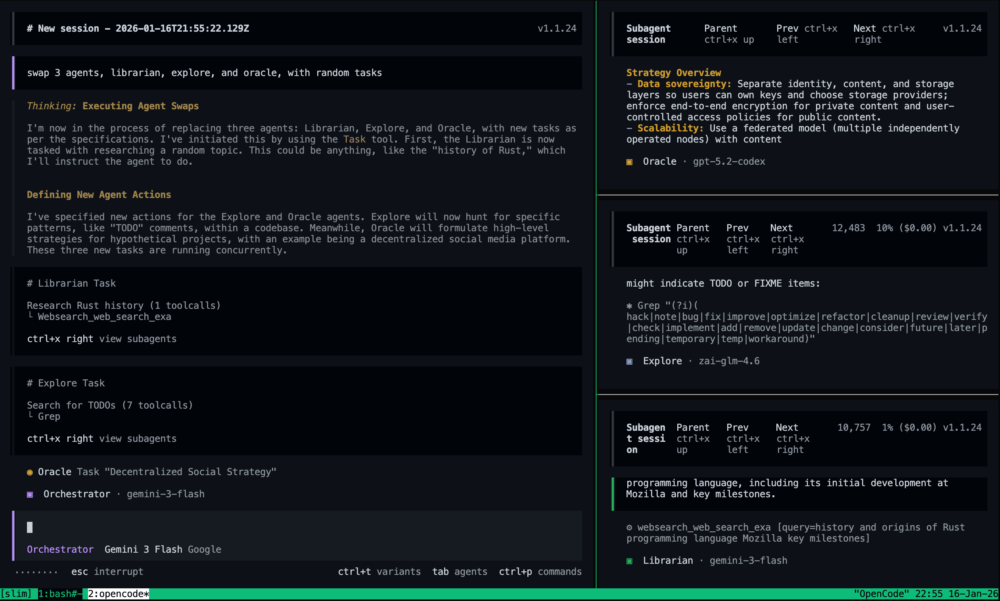

# Multiplexer Integration Guide

Use tmux, Zellij, Herdr, cmux-tui, kitty, WezTerm, or Orca to watch subagents
work in live views (split panes, or for cmux-tui sibling tabs) anchored to the
TUI client that displays their parent session.

> **Execution model:** panes are opened by the **TUI client** (`opencode attach`,
> or the TUI process of `opencode --port`), never by the OpenCode server. Each
> client manages only its own panes. See
> [Per-client view semantics](#per-client-view-semantics).

> **OpenCode v2 hosts:** pane creation is supported when the parent TUI talks
> to the shared background service (the default) or to an explicit `--server`
> URL. `--standalone` hosts are unsupported (fail-closed, one diagnostic per
> process) and fall back to v2's native subagent surfaces. See
> [Deployment Modes](#deployment-modes) and
> [Known Limitations](#known-limitations).

## Table of Contents

- [Overview](#overview)
- [Deployment Modes](#deployment-modes)
- [Quick Start](#quick-start)
- [Configuration](#configuration)
- [Layouts](#layouts)
- [Per-client view semantics](#per-client-view-semantics)
- [Diagnostics and Logs](#diagnostics-and-logs)
- [Known Limitations](#known-limitations)
- [Behavior Changes and Removals](#behavior-changes-and-removals)
- [Troubleshooting](#troubleshooting)

---

## Overview

When OpenCode launches child agent sessions, oh-my-opencode-slim can open panes
for those sessions automatically.

- **Real-time visibility** into agent activity
- **Automatic pane management** while tasks run
- **Easy debugging** by jumping into live sessions
- **Support for multiple projects** on different sessions or ports



*OpenCode running in tmux with live subagent panes.*

How it works:

1. The **server** runs sessions and dispatches subagents. It never creates,
   closes, or positions a pane, and never reads multiplexer environment
   variables.
2. Every **TUI client** that displays the parent session subscribes to the
   host session events and, for each eligible child session, creates a view in
   **the pane it is itself running in** — a split pane (tmux / Zellij / Herdr /
   kitty / WezTerm / Orca), or a sibling tab appended to that pane (cmux-tui).
3. The pane runs a pure view command (v1 default shown; see
   [Deployment Modes](#deployment-modes) for v2):

   ```text
   opencode attach <serverUrl> --session <childSessionId> --dir <directory>
   ```

   No prompt or instruction is ever passed to the pane; the plugin pane flow
   never creates a session and never sends a prompt. A pane is a view of a
   child that already exists.
4. When the child is deleted, or goes stable-idle, the client closes its pane.
   If the child turns busy again while its parent is still displayed, the pane
   is rebuilt at the then-current display position (never a remembered one).

Because dispatch happens only on the server, opening panes from several clients
does not multiply subagent dispatch: the number of dispatches always equals the
number of tasks the parent session started, regardless of how many panes exist.

Panes are opened only when the client can determine everything it needs. Any
uncertainty (admission mismatch, embedded host with no listener, missing
anchor, readiness timeout, adapter failure) is **fail-closed**: no pane is
created and a structured reason is logged.

## Deployment Modes

Pane behavior is fixed per host mode:

| Host start | Process shape | Server URL | Pane behavior |
|---|---|---|---|
| bare `opencode` | single process, TUI thread + embedded server, no TCP listener | sentinel, not attachable | **Not supported**: fail-closed + exactly one diagnostic |
| `opencode --port N` (or `--hostname` / `--mdns`) | single process, embedded server + listener | real | Supported (recommended single-machine path) |
| `opencode serve` + N × `opencode attach <url>` | multiple processes | real | Supported (target deployment) |
| `opencode run` | no TUI host | — | No pane (child runs in the host's native background mode) |
| `opencode --mini` | TUI host does not load plugins | — | No pane |
| v2 host, shared background service (default) | TUI client of the user-level shared service | discovered via the service registration | Supported: default viewers run `opencode mini --session <id>` and rediscover the same service; `viewer: "tui"` uses `opencode --session <id> <dir>` |
| v2 host, `--server <url>` | TUI client of an explicit server | `--server` URL | Supported: default viewers run `opencode mini --server <url> --session <id>`; `viewer: "tui"` uses `opencode --server <url> --session <id> <dir>`. The `OPENCODE_PASSWORD` secret comes from the parent process environment and is injected at pane creation through the multiplexer's spawn-time environment mechanism (see [Secret handling](#known-limitations)), never through the viewer's command line |
| v2 host, `--standalone` | private stdio server (no registration, random password, exits with the parent) | ephemeral loopback | **Not supported**: fail-closed + exactly one diagnostic; the fallback is v2's native subagent surfaces (`/subagent` opens the latest child session in a tab without moving focus — the tab is a salience and quick-switch affordance, and the displayed session stays the interaction surface) |

If the v2 shared service cannot initially resolve its URL, pane setup retries
every five seconds while enabled; unsupported host modes remain disabled.

On v2 hosts the event source is the TUI's own `data` feed
(`session.created` / `session.execution.*` / `session.idle` /
`session.deleted`). Execution events carry no directory, so the pane
lifecycle records each child's directory at `session.created` and reuses it,
exactly like the v1 directory-less path; reads (session list, running set)
go through the authenticated TUI client instead of raw HTTP.

**Why embedded mode is not supported yet** (translated from the internal
requirements, §2.2):

> Bare `opencode` runs as a single process with two threads (TUI main thread +
> embedded server) and opens no TCP listener, so `opencode attach` in a child
> pane has no URL to connect to, and the plugin cannot create a listener on the
> host's behalf either. Pane creation therefore requires the server to be
> reachable over a URL — use `opencode --port <port>` or `opencode serve` +
> `opencode attach <url>`. When this mode is detected, the feature is turned off
> and exactly one diagnostic is recorded.

The diagnostic for this case is the `host-unreachable` reason (see
[Diagnostics and Logs](#diagnostics-and-logs)); it is emitted **exactly once per
process**. `opencode run` and `opencode --mini` never initialize the pane
wiring at all, so they produce no panes and no diagnostic noise.

## Quick Start

### 1. Enable the multiplexer

Edit `~/.config/opencode/oh-my-opencode-slim.json` (or `.jsonc`):

**Auto-detect (recommended):**

```jsonc
{
  "multiplexer": {
    "type": "auto",
    "layout": "main-vertical",
    "main_pane_size": 60
  }
}
```

**A specific adapter:**

```jsonc
{
  "multiplexer": {
    "type": "tmux"
  }
}
```

`type` is resolved **per client**: the client checks its own environment and
only enables panes when the configured adapter matches what it detects.

### 2. Start OpenCode with a reachable server

**Single machine (embedded TUI with a listener):**

```bash
tmux            # or zellij / herdr / kitty / wezterm / orca / cmux-tui
opencode --port 4096
```

Do not hard-code a fixed port when running several instances — pick a free one.

**Multiple clients / remote server (target deployment):**

```bash
opencode serve --port 4096
```

then, inside each multiplexer pane that should display the session:

```bash
opencode attach http://127.0.0.1:4096
```

### 3. Adapter-specific setup

**Tmux** — no setup. The client is detected via `TMUX_PANE` and addresses its
own tmux server with `-S <socket>` taken from `TMUX`.

**Zellij** — requires Zellij **0.44.1 or newer**. Detected via
`ZELLIJ_PANE_ID`; every command is addressed with `--session <name>` from
`ZELLIJ_SESSION_NAME`. Child panes always open in the tab containing the parent
pane — there is no dedicated agents tab and no tab switching.

**Herdr** — detected via `HERDR_PANE_ID`. Herdr's own OpenCode lifecycle
integration can be installed separately:

```bash
herdr integration install opencode
```

After each spawn and each agent-pane close, the plugin re-equalizes the agent
panes through Herdr's socket API (`layout.export` /
`layout.set_split_ratio`), so sibling agent panes keep equal sizes (heights in
the `main-vertical` agent column, widths in the `main-horizontal` agent row).
The split that bounds the main pane is reset separately to `main_pane_size`.
Only panes this client spawned are equalized, so an unrelated pane that shares
the tab keeps its own ratio.
Manual resizes persist until the next spawn or close, and a zoomed tab is left
untouched. Equalization is best-effort —
failures are logged and never affect pane creation or closure. Set
`multiplexer.equalize_panes` to `false` to skip this step and keep manual pane
sizes.

**cmux-tui** — the `cmux-tui` value of `multiplexer.type` selects the
cross-platform Rust TUI (`cmux.protocol/2`; `cmux-tui-v0.13.3+` is the
practical floor). Detected via `CMUX_TUI_SOCKET` (preferred) or legacy
`CMUX_MUX_SOCKET`; the anchor is resolved from `CMUX_TUI_TERMINAL_ID`.
Availability is a protocol read self-check, not `--version` — the binary
reports its crate version (`0.1.0`), which has nothing to do with the npm
distribution's version.

> **cmux-tui is not the macOS app.** `cmux` on macOS is a **different product
> that only shares the name**. It speaks the 0.64.x surface model
> (`CMUX_SOCKET_PATH`, `CMUX_SURFACE_ID`, `CMUX_PANEL_ID`,
> `CMUX_REMOTE_TRANSPORT`, `CMUX_BUNDLED_CLI_PATH`, …), none of which this
> adapter reads, and it ships **its own bundled CLI** — normally installed as
> `~/.cmux/bin/cmux`, where it shadows cmux-tui on `PATH` and where `cmux ssh`
> will overwrite it (deleting a cmux-tui binary that lived there). Neither the
> app nor its bundled CLI is supported. The plugin resolves the binary from
> `multiplexer.cmux_tui_binary` when set, then `which cmux-tui`, then
> `which cmux` (this last fallback is how the app's bundled CLI can be picked
> up; the probe logs `[cmux-tui] findBinary: found <path>`). Set the config
> key, or make sure the real cmux-tui comes first on `PATH`.

Child views are **sibling tabs appended inside the parent pane**, created
already named with the human-readable `parent_name/child_name` form
(`pane <parent pane> run --on-exit keep --name <parent_name/child_name> --
<attach argv>`). `parent_name` is the parent tab's `name`, or `Agent<plugin
pid>` when it is empty; `child_name` is `<subagent_type>:<up to 5 characters of
the child session id>` (`subagent` when the type is unavailable; for example
`Agent770446/oracle:GdEx6`). New tabs are
appended at the end (no reordering), and the pane's previously active tab is
restored after creation (falling back to the parent tab when it cannot be
determined). Closing uses `terminal close`, which removes every view of the
terminal **and ends its process** — unlike `tab close` / `pane close`, which
leave a zero-view process alive. cmux-tui has **no layout expression**:
`multiplexer.layout` and `multiplexer.main_pane_size` are ignored (no command
is issued).

**Kitty** — requires `allow_remote_control` **and** `listen_on` in
`kitty.conf`:

```conf
allow_remote_control yes
listen_on unix:/tmp/kitty-rc-$(USER)
```

`listen_on` makes kitty export `KITTY_LISTEN_ON` to its child processes
(including OpenCode); the plugin passes it through to every `kitten @`
invocation. After editing `kitty.conf`, **restart kitty** so the socket is
created, and verify with `kitten @ ls` from a normal shell.

**WezTerm** — no configuration needed. WezTerm exports `WEZTERM_PANE`,
`WEZTERM_UNIX_SOCKET`, and `WEZTERM_EXECUTABLE` to every pane, and the plugin
drives it through the `wezterm` CLI installed next to the running GUI
(falling back to `PATH`), always with `--no-auto-start` so a stale socket
fails instead of starting a background mux server. Verify with
`wezterm cli list` from a normal shell. Auto detection checks WezTerm last,
so tmux or Zellij running inside WezTerm still wins. Native Windows is
unsupported and untested: without `SHELL` the adapter reports unavailable,
and an MSYS-style `SHELL` may not resolve for native `wezterm.exe`.

**Orca** — no configuration needed. Orca exports `ORCA_TERMINAL_HANDLE` (the
handle of the pane running OpenCode) and `TERM_PROGRAM=Orca`; the plugin
resolves the CLI from `$ORCA_CLI_BIN_DIR/orca`, falling back to `orca` on
`PATH`, and probes availability with `orca status --json`. Child panes are
splits of that anchor terminal (`orca terminal split --terminal <handle>
--direction … --command …`), and the returned split handle is the pane id the
plugin closes with (`orca terminal close --terminal <handle>`). Verify with
`orca terminal list --json`. Auto detection checks Orca after cmux, tmux,
Zellij, Herdr and kitty, so a nested session inside an Orca terminal still
wins. Two limits: `terminal split` has no `--cwd`, so panes open at the
worktree path, and Windows hosts are refused (see
[Known Limitations](#known-limitations)).

### 4. Trigger delegated work

Ask OpenCode to do something that launches subagents. New panes appear next to
the pane that displays the parent session (for cmux-tui, a new tab appears
inside that pane).

## Configuration

```jsonc
{
  "multiplexer": {
    "type": "auto",
    "layout": "main-vertical",
    "main_pane_size": 60
  }
}
```

| Setting | Type | Default | Description |
|---------|------|---------|-------------|
| `type` | string | `"none"` | `"auto"`, `"tmux"`, `"zellij"`, `"herdr"`, `"cmux-tui"`, `"kitty"`, `"wezterm"`, `"orca"`, or `"none"` |
| `layout` | string | `"main-vertical"` | Layout preset: `main-vertical`, `main-horizontal`, `tiled`, `even-horizontal`, `even-vertical`. Each adapter maps it to its nearest native expression; cmux-tui has no layout expression and ignores it, and Orca only maps it to a split direction at spawn time (see [Layouts](#layouts)). Herdr builds an agent area for both `main-*` layouts and re-equalizes only its agent panes after each spawn/close |
| `main_pane_size` | number | `60` | Main pane size percentage (`20`–`80`). Applied by tmux for the `main-*` layouts, and by Herdr (first agent-area split of the `main-*` layouts; the agent panes in the resulting column or row are then re-equalized after each spawn/close while the main pane keeps this share) and WezTerm (first agent split); ignored by Zellij, kitty, cmux-tui, and Orca |
| `equalize_panes` | boolean | `true` | Herdr only: after each spawn and agent-pane close, equalize the `main-*` agent panes and re-assert the main pane's `main_pane_size` share through Herdr's socket API. Set `false` to keep manual pane sizes |
| `cmux_tui_binary` | string | omitted | Explicit path to the cmux-tui binary. When omitted, the client resolves `cmux-tui` first, then `cmux`, on `PATH` |
| `viewer` | string | `"tui"` on v1, `"mini"` on v2 | Subagent pane surface: `"tui"` (full interface) or `"mini"` (lightweight interface). Explicit values override the host default. On v1, `"mini"` requires OpenCode >= 1.17.10 and runs `opencode attach <url> --session <id> --dir <dir> --mini`, without additional pane-cwd pinning. On v2 it runs `opencode mini` without a positional directory, so adapters pin the cwd (herdr/kitty/WezTerm natively, tmux `-c`, Zellij `--cwd`, cmux-tui and Orca `cd` for POSIX shells and fish). Changing the value takes effect on the next opencode start |

All `multiplexer.*` values are read by the client only. An invalid value
disables pane management (fail-closed) with a once-per-process diagnostic.

## Layouts

The five standard layouts and their fixed mapping per adapter. Where an adapter
has no exact equivalent, it uses the nearest native expression (marked
*approximate*); `main_pane_size` applies to tmux `main-*` layouts and the first
Herdr/WezTerm agent split. Herdr then equalizes only its agent panes after each
spawn/close, leaving the main pane's share intact, while cmux-tui ignores both
settings entirely (its child views are tabs inside the parent pane, not panes in
a layout) and Orca ignores `main_pane_size` (it has no layout primitives, so the
layout only picks the split direction at spawn time).

| Layout | tmux | Zellij | Herdr | kitty | WezTerm | Orca | cmux-tui |
|--------|------|--------|-------|-------|---------|------|------|
| `main-vertical` | `-h` split, then `select-layout main-vertical` (+ `main-pane-width`) | `new-pane --direction right` | `pane split --direction right`; *approximate* agent column (below) | `tall` layout | `split-pane --right --percent <100 - main_pane_size>`; *approximate* agent column (below) | `terminal split --direction horizontal` from the anchor; *approximate*, unsized | ignored (no layout expression) |
| `main-horizontal` | `-v` split, then `select-layout main-horizontal` (+ `main-pane-height`) | `new-pane --direction down` | `pane split --direction down`; *approximate* agent row (to the right) | `fat` layout | `split-pane --bottom --percent <100 - main_pane_size>`; *approximate* agent row | `terminal split --direction vertical` from the anchor; *approximate*, unsized | ignored (no layout expression) |
| `even-horizontal` | `-h` split, then `select-layout even-horizontal` | no direction (Zellij's native placement) | `pane split --direction right` | `horizontal` layout | `split-pane --right` from the parent | `terminal split --direction horizontal` from the anchor | ignored (no layout expression) |
| `even-vertical` | `-v` split, then `select-layout even-vertical` | no direction (native placement) | `pane split --direction down` | `vertical` layout | `split-pane --bottom` from the parent | `terminal split --direction vertical` from the anchor | ignored (no layout expression) |
| `tiled` | `-h` split, then `select-layout tiled` | no direction (native placement) | `pane split --direction right` | `grid` layout | `split-pane --right` from the parent | `terminal split --direction horizontal` from the anchor | ignored (no layout expression) |

Adapter notes:

- **tmux** — `select-layout` is applied only to anchor panes this client itself
  split into (panes it created are tracked per anchor), debounced by 150 ms so
  concurrent child starts do not thrash the window. `main-*` layouts also set
  `main-pane-width` / `main-pane-height` from `main_pane_size`.
- **Zellij** — direction is only a hint: when a tab is crowded (Zellij silently
  drops a directed split around ~4 stacked panes), the create is retried once
  without a direction and Zellij places the pane in the largest free space of
  the same tab. There is no layout rebalancing.
- **Herdr** — `main-*` layouts are approximated: the first child opens the
  agent area at `main_pane_size` (`right` for `main-vertical`, `down` for
  `main-horizontal`), and later children stack inside that agent-area pane
  (below for `main-vertical`, to the right for `main-horizontal`); if it is
  closed, the next spawn recreates it from the parent. `even-*` and `tiled`
  always split the parent, without a ratio. Herdr builds that reject the
  `pane split --ratio` flag are detected at runtime: the split is retried once
  without it and the capability stays disabled for the process, so panes keep
  working (the main pane then keeps Herdr's 50/50). After every successful
  spawn and agent-pane close, the layout is corrected via `layout.export` /
  `layout.set_split_ratio`: each agent-only subtree is split evenly (a
  perpendicular split keeps the larger side's span), and the main/agent
  boundary is re-asserted to `main_pane_size`, which also repairs a fallback
  split that could not be sized. Manual resizes persist until the next spawn
  or close; zoomed tabs are skipped. Set `multiplexer.equalize_panes` to
  `false` to disable the socket-based correction entirely.
- **kitty** — kitty has no per-window layout API. The mapped built-in layout
  (`tall` / `fat` / `grid` / `horizontal` / `vertical`) is applied to the tab
  containing the parent window via `goto-layout --match=window_id:<id>`, and
  the new window is placed next to the parent with `--next-to=id:<id>` (`id:`
  is the window search field; `window_id:` is tab-level and must not be used
  there). A layout that is already applied is not re-applied.
- **WezTerm** — no preset layouts, so the layout is built from split order
  like Herdr: for `main-*` the first child splits the parent at `100 -
  main_pane_size` percent, and later children stack inside that agent pane
  (below for `main-vertical`, to the right for `main-horizontal`); if it is
  closed, the next spawn recreates it from the parent. `even-*` and `tiled`
  always split the parent. There is no rebalancing. Stacking falls back to
  the parent only when WezTerm reports the agent pane as gone (`pane_id N
  invalid`); any other split failure is reported as an error without a
  second split, because a split that fails to report can still have created
  a pane. `split-pane` focuses the new pane, so the pane the user had focused
  before (from `wezterm cli list-clients`) is focused again, or the parent
  when that cannot be read. As with Herdr, closing the first agent pane
  while stacked siblings remain starts a new agent column at the next spawn.
  Closing sends Ctrl+C and then `kill-pane`; a failure counts as closed only
  on WezTerm's `no such pane N` error, so a transient CLI error keeps the pane
  tracked instead of forgetting a live viewer.
- **Orca** — no layout primitives: `applyLayout` is a no-op and
  `main_pane_size` is ignored. The layout only selects the split direction at
  spawn time (`horizontal` for `main-vertical`, `even-horizontal` and `tiled`;
  `vertical` for `main-horizontal` and `even-vertical`), and every child
  splits the anchor terminal — there is no agent area, no sizing and no
  rebalancing. `horizontal` is assumed to mean side-by-side. A split is
  bounded (5 s); a timeout is logged and reported as a soft failure, because
  the pane may still have opened. Closing is immediate (`orca terminal
  close`, no Ctrl+C grace) and a failed close keeps the pane tracked.
- **cmux-tui** — no layout expression: child views are tabs inside the parent
  pane, so `multiplexer.layout` and `multiplexer.main_pane_size` are ignored
  and no layout command is issued.

## Per-client view semantics

A pane is a **view**, and views belong to the viewer:

- Every independently opened TUI client that displays the parent session manages **its own** panes.
  Two clients displaying the same parent session and the same child each get
  their own pane, anchored to their own parent pane (next to it, or inside it
  as a tab for cmux-tui). This is expected, not a leak: anchors, control planes,
  and view handles are all client-local.
- Full TUI viewers spawned by Slim do not manage panes, even after navigating
  to a parent session; they therefore do not open panes for grandchildren.
- There are **no cross-process files and no coordination** between clients. A
  client never writes where it is, and never touches another client's panes.
- A single client maintains **at most one pane per child session** (in-process
  state); duplicate/replayed events and reconnect compensation cannot create a
  second pane in the same client.
- Dispatch count is independent of pane count: multiple views of one child do
  not cause additional subagent dispatches.
- Switching the displayed session does not leak panes: status/idle/deleted
  events for children this client already holds keep being processed, so their
  panes still close under the normal rules. Reconciliation also checks held
  panes of other parents for lost idle or deletion signals. A rebuild requires the
  parent to be the displayed session again at that moment.
- A displayed-session or project change triggers a debounced reconciliation;
  the 30-second periodic pass remains a fallback.

If you do not want a pane on a particular client, disable panes for that
project there (`"type": "none"`), or simply close the pane; the child session
keeps running on the server.

## Diagnostics and Logs

The client initializes plugin logging and records every "no pane" outcome with
a structured, distinguishable reason:

| Reason | Meaning |
|--------|---------|
| `admission-none` | `multiplexer.type` is `"none"` |
| `admission-mismatch` | An explicit adapter is configured but the client is inside a different one |
| `admission-unavailable` | `auto` detected no supported multiplexer, or the config was invalid |
| `not-our-child` | The child's `parentID` is not the session this client currently displays |
| `host-unreachable` | Embedded host (no listener / sentinel URL) or the server probe failed |
| `readiness-timeout` | The child did not appear in `/session/status` (v2: neither in the directory's newest session page nor running) within the bounded retry budget |
| `adapter-unavailable` | The adapter cannot run here (binary missing, old version, protocol self-check failed, no control plane, or the platform/shell cannot support the viewer-secret bridge) |
| `adapter-not-found` | The adapter could not resolve its anchor target; **no multiplexer command is issued** |
| `adapter-hard` | The multiplexer command failed for another reason |
| `backfill-skipped` | Reconnect compensation found this client already holds that child's pane |

Every successful creation logs the full identity: child session, parent
session, adapter, view handle (for cmux-tui the terminal id), and the anchored
target the view was created in. Admission and host diagnostics are emitted at
most once per cause per process. On a v2 host that cannot host panes
(`--standalone`, or a malformed launch mode) a configured `multiplexer.type`
produces one `multiplexer.host-unsupported` record per process; shared and
`--server` hosts never log that record.

**Log paths:**

- Client (TUI): `$HOME/.local/share/opencode/log/oh-my-opencode-slim.tui-<stamp>.log`
  (honors `OPENCODE_LOG_DIR`; does not follow `XDG_DATA_HOME`)
- Server: `$HOME/.local/share/opencode/log/oh-my-opencode-slim.<stamp>.log`

## Known Limitations

- **Crash-leftover views are best-effort.** Views carry adapter-specific
  metadata encoding the owner pid and child session id (except WezTerm, whose
  CLI cannot set a pane title, and Orca, which sets none because the pane's
  shell auto-titles over it — neither adapter's leftovers are ever swept). tmux /
  Zellij / Herdr / kitty write it into the pane title (`omosc:<owner pid>:<child session id>`);
  cmux-tui embeds a `# omosc:<owner pid>:<child session id>` data marker in the
  spawned process's argv instead (its tab name is the human-readable
  `parent_name/child_name` name). On startup/reconnect the client scans its own
  multiplexer for views whose owner process is dead **and** whose child session
  is gone, closing them. tmux 3.0a and later also store the marker in a pane
  option, so host title changes do not erase it. No minimum tmux version is
  enforced; older versions fall back to the pane title. For title-only adapters,
  the host may overwrite that title, leaving a pane to close manually. For cmux-tui the
  sweep discovers candidates from `terminal list` and reads each terminal's
  argv with `terminal <sel> process show`, so user terminals are never touched.
  Exited terminals still appear in `terminal list` and still return their
  argv, so leftover tabs whose process already exited are cleaned up as well.
  Two classes are still left for you to close manually: views spawned under a
  `cmd.exe` shell, where the data marker cannot be written as a comment and is
  omitted (so the sweep cannot identify them), and legacy cmux-tui leftovers
  from the previous implementation. Cross-multiplexer leftovers are always
  manual.
- **cmux-tui child views occupy the parent pane's tab bar.** Each subagent gets
  a tab in the parent pane, appended at the end and never reordered; tabs are
  reclaimed when the child is deleted or closes on stable idle. This is the
  visible cost of the causally correct placement: a sibling tab cannot be
  misread as a child of another tab.
- **Closing a cmux-tui child tab can collapse the pane.** If the parent tab has
  already been closed and the child tab is the pane's last tab, closing the
  child removes the pane itself (cmux-tui's own lifecycle rule). This only
  happens after you have removed the parent view.
- **Closing the currently active view changes the active view.** The close path
  never touches the user's focus, with one unavoidable exception: when the view
  being closed is itself the active one, the active view necessarily changes
  (there is no close primitive that removes a view without that side effect).
  cmux-tui shows this whenever a child tab is the parent pane's active tab; this
  is accepted, not a defect.
- **Legacy cmux-tui leftovers need manual cleanup.** The previous cmux-tui
  implementation wrote `omosc:<pid>:<session>` into the pane name; the new
  sweep identifies cmux-tui views only by the argv data marker, so those legacy
  panes cannot be recognized and must be closed by hand.
- **Orca panes open at the worktree path.** `orca terminal split` has no
  `--cwd`, so the viewer starts in the directory Orca opens for the split
  (the worktree path) rather than the project directory; child sessions that
  inherit the worktree directory are unaffected. The v2 `mini` viewer, which
  has no directory argument, runs `cd <dir> && …` first (POSIX shells and
  fish).
- **Orca has no layout primitives.** `applyLayout` is a no-op and
  `main_pane_size` is ignored: the layout only picks the split direction at
  spawn time, every child splits the anchor terminal, and nothing is ever
  resized or rebalanced.
- **A timed-out Orca split is a soft failure.** The split command is bounded
  (5 s); a timeout is logged and reported as `adapter-unavailable`, never as
  pane loss, because the split may still have opened the pane. Since Orca
  titles cannot carry the sweep marker, such a pane is never swept — close it
  manually if it appears.
- **Orca pane titles are best-effort and unused.** `orca terminal
  set-pane-title` works, but the pane's shell auto-titles over it, so the
  plugin sets no title and never reads one back; crash-leftover Orca views are
  left for you to close manually (same stance as WezTerm).
- **Windows Orca hosts are refused.** `spawnPane` reports unavailable on
  win32 instead of typing a POSIX-quoted viewer command into a cmd/PowerShell
  pane (the #1620 class of bug). No pane is created.
- **Stable idle is a debounce, not task-level completion.** A pane closes when
  the child stays idle past the debounce window (default 5 s) and a final
  re-check finds it not busy: an absent `/session/status` entry counts as
  quiescent (opencode removes the entry when a turn ends), while `busy`/`retry`
  or an unreadable status keeps the pane. A child that goes briefly idle
  between model turns can therefore close and be rebuilt when it turns busy
  again (a visible flap). Session deletion always closes immediately.
- **Same-window layout interleaving is decorative.** tmux `select-layout`
  rebalances the whole window; two clients sharing one tmux window can
  interleave layout updates. Scope is limited to anchors this client created,
  but visual interleaving is possible and harmless.
- **On v1, readiness requires the child to be live.** Before creating a pane
  the client polls `/session/status` with the project directory (sent as the
  pre-encoded `x-opencode-directory` header) with bounded retries. A child that
  was created but never ran never appears in the live status table and gets no
  pane (`readiness-timeout`). Real `task` dispatches make the child busy
  immediately, so this only affects synthetic sessions created through the REST
  API. On v2 the status reader also lists idle sessions, so such a child still
  gets a pane as long as it is among the directory's 200 newest sessions.
- **Embedded hosts and v2 `--standalone` hosts have no pane feature** (see
  [Deployment Modes](#deployment-modes)). On v2 `--standalone`, a configured
  `multiplexer.type` is ignored and one diagnostic per process is logged; use
  `/subagent` or the host's subagent picker instead. Opening the child tab is
  deliberately a salience and quick-switch affordance: it does not move focus,
  because the displayed session stays the interaction surface.
- **v2 viewers are clients, not read-only views.** A pane opens `mini` by
  default, or the full TUI with `viewer: "tui"`. Opening a session replaces
  the process environment its shell commands use (the last client to open it
  wins), and unread/attention state is shared across clients by the server.
- **Secret handling (v2 `--server` hosts).** The viewer authenticates with
  `OPENCODE_PASSWORD`. Where the multiplexer CLI has a spawn-time env flag,
  the secret is injected there and exists only in the new pane's environment:
  tmux `split-window -e OPENCODE_PASSWORD=…`, herdr `pane split --env …`,
  kitty `kitten @ launch --env …`. Zellij, WezTerm, cmux-tui, and Orca have no
  such flag, so the pane launch script reads the value from the plugin process's own
  `/proc/<pid>/environ` (readable by the owning user only) and exports it
  before the viewer starts; the secret never enters command text or argv.
  This is the same `OPENCODE_PASSWORD` (falling back to
  `OPENCODE_SERVER_PASSWORD`) lookup the v2 client itself performs to
  connect, so a password-protected explicit server already requires it in
  the TUI's environment — the native flags read that same value, the `/proc`
  bridge reads the launch-time snapshot, and the panes need nothing extra.
  A value that only appears after the TUI started (for example exported into
  a shell later) is not picked up; if the server requires a password and
  none is available, the viewer reports the missing password.
  Residual exposure: the value is visible in the multiplexer client's argv
  for the duration of the spawn call (millisecond-scale), and — like any
  environment entry — is readable by same-user processes inspecting the
  viewer's environment; it never appears in the viewer's command line, shell
  history, or pane scrollback. Limitation: the `/proc` bridge reads the
  value line-wise, so a password containing newlines is recovered only up to
  its first line — use a single-line password. The bridge is gated and fails
  closed: no pane is created, the adapter emits one structured diagnostic per
  process with the reason code below, and the lifecycle additionally records
  its per-attempt `adapter-unavailable` outcome. Zellij requires Linux
  (`password-bridge-requires-linux`); cmux-tui requires Linux **and** a
  POSIX shell — sh/bash/zsh/dash/ksh
  (`password-bridge-requires-linux` / `password-bridge-requires-posix-shell`).
  WezTerm requires Linux and a POSIX shell, with the same reason codes. On
  v1, WezTerm also uses the bridge when the TUI's environment has
  `OPENCODE_SERVER_PASSWORD`: it exports only that variable (never a v2
  `OPENCODE_PASSWORD`) for `opencode attach`, plus `OPENCODE_SERVER_USERNAME`
  when set. tmux 3.0+ forwards those v1 variables via `split-window -e`;
  older versions rely on the tmux server's inherited environment.
  A TUI attached with `attach -p` but without the environment
  variable gets no forwarded password, so its viewer panes cannot
  authenticate. The client wiring itself must also be able to authenticate
  against a v1 password-protected server (see `host-unreachable` under
  Troubleshooting).
- **Nested multiplexer detection priority is unchanged** (for example, kitty
  inside herdr), and a client only opens panes for children of the session it
  currently displays.
- **Pane scope is the project directory the TUI loaded with.** The pane
  lifecycle is scoped to the directory the TUI plugin started with
  (`api.state.path.directory` at load time). On a default install this never
  changes (`/sessions` is scoped to the current directory and `/move` moves
  the session, not the TUI). With the experimental workspaces feature
  (`OPENCODE_EXPERIMENTAL_WORKSPACES`) the directory can change at runtime
  (`/warp`, deleting the current workspace via `/workspaces`, or opening a
  session that belongs to another workspace), and pane management does not
  re-scope until the TUI is restarted. (Follow-up: re-scope the wiring and
  re-run admission when the route directory changes.)

## Behavior Changes and Removals

This release moves pane execution from the server to the TUI client. Every
removed or changed behavior, with migration guidance:

| # | Item | Old behavior | New behavior | Migration |
|---|------|--------------|--------------|-----------|
| 1 | `multiplexer.zellij_pane_mode` + agent-tab | Dedicated `opencode-agents` tab; `current-tab` opted into the parent tab | Removed: ignored with a warning. Zellij panes always open in the parent pane's tab | Delete `zellij_pane_mode` from config |
| 2 | tmux pane location registry | The TUI wrote `…/opencode/storage/oh-my-opencode-slim/tmux-panes/<hash>.json` (session → `TMUX_PANE`, owner pid, 30 s TTL); the server read it and otherwise fell back to the **server's own** `TMUX_PANE` | No cross-process files at runtime. Each client anchors on its own `TMUX_PANE`, re-resolved at spawn time, and addresses its own tmux server via `-S <socket>` from `TMUX` | None. Stale `tmux-panes/*.json` files can be deleted; nothing reads them |
| 3 | Deferred close for background jobs | On idle, the server checked the in-memory background job board; if a job was running the close was skipped and retried when the job finished (no debounce) | Client-side **stable-idle debounce** (default 5 s) plus a final idle re-check; busy within the window cancels the close; deletion closes immediately | None. If a child idles between turns, expect a close/rebuild flap (accepted; see [Known Limitations](#known-limitations)) |
| 4 | cmux-tui adapter | The macOS app — a different product that only shares the name (0.64.x, surface model): `CMUX_SOCKET_PATH` / workspace / surface ids, readiness polling, deferred spawn retries, orphan cooldowns, finite close budgets, hot-reload takeover, and vertical `equalize` rebalancing | Rewritten for **cmux-tui** (`cmux.protocol/2`): `CMUX_TUI_SOCKET` (or legacy `CMUX_MUX_SOCKET`), two-hop anchor (`CMUX_TUI_TERMINAL_ID` → terminal → tab → pane), a sibling tab appended inside the parent pane (`pane run --on-exit keep --name <parent/child> -- <argv>`), `terminal close`; availability by protocol read self-check, never `--version`; no cooldowns, budgets, deferred spawns, registries, `equalize`, or screen-level splits | Install **cmux-tui** (`cmux-tui-v0.13.3+`). The macOS app and the CLI it bundles are out of scope; macOS and Linux use the same cmux-tui binary and interface |
| 7 | Embedded-mode restriction | Best-effort behavior with the server's environment; no listener required by design | Bare `opencode` (no TCP listener) is **fail-closed**: no pane and exactly one `host-unreachable` diagnostic; the plugin cannot create a listener for the host | Start with `opencode --port <port>`, or use `opencode serve` + `opencode attach <url>` |
| 9 | Server-side pane execution | `src/index.ts` built a multiplexer session manager and routed `session.created/status/idle/deleted` on the server; pane code read multiplexer env from the server process | Pane code lives only in the TUI entry's dependency graph. The server never creates, closes, or positions a pane and never reads multiplexer environment variables (invariant I1) | None. Headless hosts are unaffected; v2 TUI hosts wire the lifecycle through the v2 host adapter (shared/`--server` supported, `--standalone` fail-closed) |
| 11 | `multiplexer.type: "cmux"` value | The type value `"cmux"` selected the cmux-tui adapter | The value is renamed to `"cmux-tui"`; `"cmux"` is no longer a valid type, so the key is dropped, the type falls back to `"none"` (pane management disabled), and a once-per-process diagnostic reports the rename | Rename the value to `"cmux-tui"` |

## Troubleshooting

**No panes at all**

1. Check the client log
   (`$HOME/.local/share/opencode/log/oh-my-opencode-slim.tui-*.log`) for the
   `no pane` reason.
2. `admission-none` → set `multiplexer.type` to `auto` or the right adapter.
3. `admission-mismatch` → the configured adapter is not the one the client is
   inside (for example `type: "zellij"` while running in tmux).
4. `host-unreachable` → on v1 the host has no reachable listener; restart with
   `--port` or use `serve` + `attach`. For a v1 server started with
   `OPENCODE_SERVER_PASSWORD`, the client authenticates its probe and session
   reads with the same basic auth `opencode attach` uses: the header from
   `attach -p/--password` (and `-u/--username`), or else
   `OPENCODE_SERVER_PASSWORD` / `OPENCODE_SERVER_USERNAME` in the TUI's
   environment. A 401 therefore means neither was provided or they do not
   match the server. On v2 shared or `--server` hosts the
   authenticated `server.info()` probe failed; check the shared service or the
   `--server` URL.
5. `readiness-timeout` → the child never became visible in `/session/status`
   (v2: neither in the directory's newest session page nor running; see
   [Known Limitations](#known-limitations)).

**Panes open in the wrong place**

- The view is always created in the pane that displays the parent session at
  spawn time: a split for tmux / Zellij / Herdr / kitty / WezTerm / Orca, or a
  tab inside that
  pane for cmux-tui. Move the parent session to another pane/multiplexer first;
  a rebuild after the child turns busy follows the new position.
- Missing anchor (`adapter-not-found`) means no multiplexer command was issued
  at all — the client could not resolve its own anchor from the environment.

**Zellij**

- Older than 0.44.1 → the adapter reports unavailable and is skipped.
- In a crowded tab, the directed split is retried without a direction; the pane
  still lands in the same tab.

**Kitty**

- `KITTY_LISTEN_ON` missing → add `listen_on` to `kitty.conf` and restart
  kitty; verify with `kitten @ ls`.

**WezTerm**

- `adapter-unavailable` with a server password → the `/proc` password bridge
  needs Linux and a POSIX shell (sh/bash/zsh/dash/ksh); the client log shows
  `password-bridge-requires-linux` or `password-bridge-requires-posix-shell`.
- Focus moves to the parent pane after a spawn → `wezterm cli list-clients`
  could not be read, so focus fell back to the parent.
- Errors such as `Error while decoding response pdu` mean the `wezterm` CLI
  and the running WezTerm GUI are different versions (typically after an
  upgrade without restarting WezTerm). A command can then act but report
  failure: the adapter then reports an error instead of splitting again, but
  the pane WezTerm did create is not tracked and must be closed manually.
  Idle viewer panes may also stay open, because a failed `kill-pane` keeps
  them tracked instead of guessing. Restart WezTerm.

**cmux-tui**

- `adapter-unavailable` → the resolved binary is not cmux-tui. The usual cause
  is the macOS app's bundled CLI shadowing it on `PATH` (the app installs
  itself as `~/.cmux/bin/cmux`, and `cmux ssh` rewrites that path). Check the
  path reported by the `findBinary: found` line in the client log to see which
  binary was picked; the log redactor masks opaque runs of 33+ characters
  (4 leading + 2 trailing survive), so a deeply nested path prints as
  `/tmp/…ux` while typical install paths print in full. Then set
  `multiplexer.cmux_tui_binary` to the real cmux-tui binary or put it first on
  `PATH` — the explicit key is tried before any `PATH` probe.

**Panes close and reopen**

- The child idled past the debounce window and then turned busy again. This is
  the accepted stable-idle semantics; see
  [Known Limitations](#known-limitations).

**Leftover views after a client crash**

- The sweep is best-effort, and WezTerm and Orca panes are never swept (close
  them manually). For older tmux / Zellij / Herdr / kitty it often cannot
  match a pane whose title was rewritten by `opencode attach`. For cmux-tui it
  identifies views by the `# omosc:...` argv marker; exited terminals keep that
  argv and `terminal close` still works on them, so a crashed client's leftover
  tabs are recognized whether or not their process is still running. Only
  legacy cmux-tui leftovers created by the previous implementation (which wrote
  `omosc:` into the pane name) are not recognized. Close such views manually.
